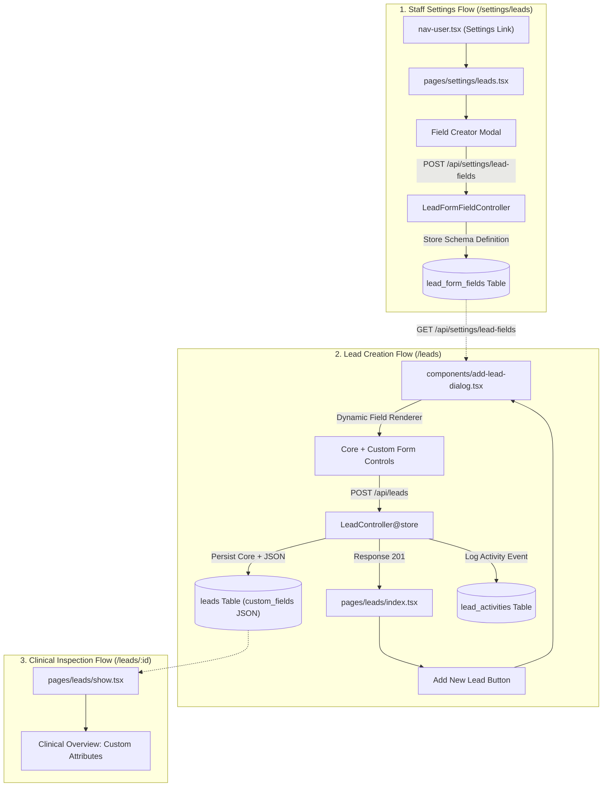

# Dynamic Medical Lead Capture & Field Customization Engine

* **Author:** allwyn46
* **Status:** Draft
* **Date:** 2026-11-09

--------------------------------------------------------------------------------

## Overview

Medipro clinic staff need a standardized workflow to manually capture clinical patient inquiries directly from the Leads Management dashboard (`/leads`), coupled with staff-driven customization to configure dynamic intake fields without developer intervention. This design establishes:

1. A comprehensive modal lead capture form triggered by the `Add New Lead` button on the `/leads` page.
2. A Settings link in the user account sidebar menu (`resources/js/components/nav-user.tsx`) directing staff to a Lead Form Configuration interface.
3. A custom field management engine allowing staff to define new form fields (Text inputs or Dropdown selectors with user-defined option sets).
4. Dynamic client-side rendering of active custom fields inside the lead creation form and persistent JSON-backed storage on the `leads` table.

## The Problem

Clinical specialties often require specialized intake details (such as insurance carrier name, preferred clinic branch, dental arch concerns, or medical alert notes) that change as clinic operations evolve. Currently, the `Add New Lead` button on the Leads page is unlinked, preventing staff from manually logging patient inquiries. Furthermore, all lead fields are strictly hardcoded, meaning any new data requirement requires a database migration, backend controller adjustment, and frontend template rewrite. Staff need a way to create leads immediately while retaining administrative control over the intake schema.

## Goals

* **G1: Accessible Manual Lead Creation**: Connect the `Add New Lead` button on `/leads` to a modal dialog capturing core medical CRM fields (Full Name, Phone, Email, Clinical Service, Assigned Doctor, Status, Priority, Total Value, Referral Source, Notes).
* **G2: User Profile Settings Entry**: Introduce a `Settings` navigation item directly beneath `Account` in the sidebar user menu (`nav-user.tsx`) directing to `/settings/leads`.
* **G3: Dynamic Field Builder**: Allow clinic staff to create custom fields with configurable types:
  * `Text`: Single-line or multiline clinical text inputs.
  * `Dropdown`: Single-select dropdowns with an interactive list of option values defined by staff.
* **G4: Dynamic Rendering & Persistence**: Render all active custom fields automatically inside the `Add New Lead` modal, validate them server-side, and persist responses in a `custom_fields` JSON column on the `leads` table.
* **G5: Audit Logging & Real-Time Reflection**: Automatically append an initial `LeadActivity` log upon creation and prepend the new lead to the TanStack table with live metrics re-indexing.

## Non-Goals

* **NG1: Public Patient Portal Modification**: Custom fields configured in staff settings will apply exclusively to the internal staff lead intake workflow, leaving the public booking portal on `/` unchanged.
* **NG2: Complex Conditional Branching**: No conditional visibility rules (e.g., "display Field Y only if Field X equals value Z") in this phase.
* **NG3: File Upload or Biometric Custom Fields**: Custom fields are restricted to `Text` and `Dropdown` types; file uploads, medical imaging attachments, and signature fields are excluded.
* **NG4: Drag-and-Drop Form Builder Canvas**: Field management will use a structured tabular list with toggleable active status and add/edit modals rather than an arbitrary drag-and-drop canvas.

## Open Questions

* **Q1: Table Column Exposure**: Should custom fields be selectable as dynamic columns in the TanStack leads table column-visibility dropdown, or should they strictly reside within the single lead Clinical Overview view (`/leads/{id}`)?
* **Q2: Historical Record Retention on Field Deletion**: When staff delete or deactivate a custom field from Settings, should existing historical values on previously created leads be preserved read-only in their JSON payload or scrubbed?

## Critical User Journeys (CUJs)

### CUJ 1: Staff Configures a Custom Dropdown Field
* **Given**: A logged-in clinic staff member opens the sidebar user profile dropdown in the lower-left navigation.
* **When**: The user clicks the `Settings` option located below `Account`, navigates to Lead Form Settings, clicks `+ Add Custom Field`, enters the label "Insurance Provider", selects type `Dropdown`, adds options `["Star Health", "Care Health", "HDFC ERGO", "Self-Pay"]`, and clicks `Save Field`.
* **Then**: The field is persisted to the `lead_form_fields` database table, appears in the active fields table in Settings, and becomes immediately available in the intake form.

### CUJ 2: Staff Logs a New Patient Lead with Dynamic Custom Fields
* **Given**: Staff member navigates to `/leads` and clicks `+ Add New Lead`.
* **When**: The modal opens displaying standard clinical fields alongside the dynamically generated "Insurance Provider" dropdown. The user fills in the patient details, selects "Care Health", and clicks `Create Lead`.
* **Then**: The backend validates the inputs, stores core attributes and the `custom_fields` JSON payload on the lead, writes an entry in `lead_activities`, closes the modal, prepends the new lead to the table with a success toast, and updates the pipeline metrics.

### CUJ 3: Staff Inspects Lead Details with Custom Attributes
* **Given**: A lead with custom attributes has been recorded.
* **When**: A doctor or staff member navigates to `/leads/{id}`.
* **Then**: The "Clinical Overview" card displays standard clinical properties along with a dedicated "Custom Field Attributes" section showing the key-value pairs recorded during intake.


--------------------------------------------------------------------------------

## Technical Plan (Architecture)

### Architectural Overview

The solution adopts a hybrid relational-document model. Dynamic field definitions (metadata, field types, and permitted dropdown option sets) are stored relationally in `lead_form_fields`. Lead answers to these dynamic fields are captured as validated key-value documents in a `custom_fields` JSON column on the `leads` table. This provides strict schema management for administrative field creation while keeping lead queries performant without multi-table joins.



### 1. Database Schema & Data Modeling

#### 1.1 `lead_form_fields` Table
Stores staff-configured dynamic field definitions.

```php
Schema::create('lead_form_fields', function (Blueprint $table) {
    $table->id();
    $table->string('label');                     // e.g. "Insurance Provider"
    $table->string('name')->unique();            // e.g. "insurance_provider" (sanitized key)
    $table->enum('type', ['text', 'dropdown']);  // text input or single-select dropdown
    $table->json('options')->nullable();         // JSON array of strings: ["Star Health", "Care Health"]
    $table->boolean('is_required')->default(false);
    $table->integer('sort_order')->default(0);
    $table->boolean('is_active')->default(true);
    $table->timestamps();
});
```

#### 1.2 `leads` Table Modification
Adds JSON payload column to store custom field values per lead.

```php
Schema::table('leads', function (Blueprint $table) {
    $table->json('custom_fields')->nullable()->after('notes');
});
```

Model casting on `app/Models/Lead.php`:
```php
protected function casts(): array
{
    return [
        'value' => 'float',
        'last_contact_date' => 'date',
        'custom_fields' => 'array',
        'created_at' => 'datetime',
        'updated_at' => 'datetime',
    ];
}
```

### 2. Backend API Interface & Validation

#### 2.1 Settings Endpoints (`LeadFormFieldController`)
*   `GET /api/settings/lead-fields`: Returns all active field definitions ordered by `sort_order`.
*   `POST /api/settings/lead-fields`: Creates a new custom field definition.
    *   **Validation**:
        *   `label`: `required|string|max:100`
        *   `type`: `required|in:text,dropdown`
        *   `options`: `required_if:type,dropdown|array|min:1`
        *   `options.*`: `required|string|max:100`
        *   `is_required`: `boolean`
    *   Generates a slugified `name` (e.g., `Str::slug($request->label, '_')`).
*   `DELETE /api/settings/lead-fields/{id}`: Sets `is_active = false` or soft deletes the field definition.

#### 2.2 Lead Intake Endpoint (`LeadController@store`)
*   `POST /api/leads`: Validates core fields and dynamic custom attributes.
    *   **Core Fields**:
        *   `name`: `required|string|max:255`
        *   `phone`: `required|string|max:50`
        *   `email`: `nullable|email|max:255`
        *   `service`: `required|string|max:255`
        *   `doctor`: `required|string|max:255`
        *   `status`: `required|in:New,Contacted,Consultation Scheduled,Treatment Plan Sent,Won,Lost`
        *   `priority`: `required|in:High,Medium,Low`
        *   `value`: `nullable|numeric|min:0` (defaults to ₹1,500)
        *   `source`: `nullable|string|max:100` (defaults to "Manual Entry")
        *   `notes`: `nullable|string|max:2000`
    *   **Custom Fields**:
        *   `custom_fields`: `nullable|array`
        *   Dynamic rule builder iterates over active `lead_form_fields`. For fields marked `is_required = true`, enforces `required` in `custom_fields.{name}`. For dropdown fields, enforces `in:{options}`.
    *   **Execution**:
        *   Persists `Lead` record with `custom_fields` array.
        *   Inserts initial `LeadActivity` log (`type: 'Note'`, `title: 'Lead Created Manually'`, `description: 'Lead recorded via clinic staff portal.'`).
        *   Returns `{ success: true, lead: $lead }`.

### 3. Frontend Component Architecture

#### 3.1 Sidebar User Menu (`resources/js/components/nav-user.tsx`)
*   Inserts a `<DropdownMenuItem>` beneath `Account` linking to `/settings/leads`.
*   Includes `SettingsIcon` from `lucide-react`.

#### 3.2 Lead Form Settings View (`resources/js/pages/settings/leads.tsx`)
*   Rendered within `Layout` with a settings page header and breadcrumbs.
*   Presents a TanStack table of all configured custom fields with:
    *   Field Label
    *   Internal Key (`name`)
    *   Type badge (`Text` in blue, `Dropdown` in purple with option count)
    *   Required indicator
    *   Actions (Toggle Active, Delete)
*   `+ Add Custom Field` dialog:
    *   Label input.
    *   Type selection dropdown: `Text Field` vs `Dropdown Field`.
    *   Dynamic Option Editor (if Dropdown selected):
        *   Text input with `Add Option` button or Enter key support.
        *   Pill list with remove `(x)` buttons for each added option.
    *   Is Required checkbox.
    *   Save button dispatching `POST /api/settings/lead-fields`.

#### 3.3 Add Lead Dialog (`resources/js/components/add-lead-dialog.tsx`)
*   Modular Dialog opened by `Add New Lead` button on `resources/js/pages/leads/index.tsx`.
*   Two-column form layout:
    *   **Left Column (Patient Contact & Clinical Assignment)**: Full Name, Phone, Email, Interested Service, Assigned Doctor, Total Value (₹).
    *   **Right Column (Status & Custom Intake Fields)**: Status, Priority, Referral Source, followed by the dynamic custom fields section.
*   Dynamic Field Renderer:
    *   Iterates through fetched custom field definitions.
    *   If `type === 'text'`: renders standard `<Input />` or `<Textarea />`.
    *   If `type === 'dropdown'`: renders `@/components/ui/select` populated with `field.options`.
*   On submit: Sends validated payload to `POST /api/leads`, shows success notification, and refreshes the table.

#### 3.4 Lead Detail View (`resources/js/pages/leads/show.tsx`)
*   In the "Clinical Overview" card, checks if `lead.custom_fields` has keys.
*   Renders each key-value pair under an "Additional Intake Details" section with humanized field labels.


--------------------------------------------------------------------------------

## Alternatives Considered

### Alternative 1: Entity-Attribute-Value (EAV) Relational Model
*   **Mechanism**: Maintain field definitions in `lead_form_fields` and store responses in a dedicated relational pivot table (`lead_custom_field_values`) with columns `(id, lead_id, field_id, value, timestamps)`.
*   **Pros**:
    *   Strict relational normalization with foreign key cascading.
    *   Individual SQL indexes can be placed on `field_id` and `value`.
*   **Cons**:
    *   Requires joining or eager-loading an additional table on every lead query across the dashboard, pipeline, and single lead views.
    *   Row bloat: 10 custom fields across 5,000 leads generates 50,000 additional table records.
    *   Complex data aggregation when serializing leads for Inertia props and TanStack tables.
*   **Reason for Rejection**: `Rejected by author: Modern MySQL and Laravel support native JSON column casting and direct JSON querying. The JSON document approach avoids query joins, minimizes database overhead, and serializes directly to Inertia without pivot mapping.`

### Alternative 2: Runtime Dynamic Schema Migrations (DDL Execution)
*   **Mechanism**: Execute `Schema::table('leads', function ($table) { $table->string($slug); })` dynamically when a staff member creates a field in Settings.
*   **Pros**:
    *   Every custom field exists as a physical SQL column on `leads`.
    *   Standard Eloquent accessors without JSON unpacking.
*   **Cons**:
    *   Executing runtime DDL statements (`ALTER TABLE`) locks the database table, causing request timeouts and potential downtime in production.
    *   High security risk allowing administrative web requests to directly execute DDL.
    *   Deleting or renaming fields requires dropping columns, risking permanent data loss without safe rollback paths.
*   **Reason for Rejection**: `Rejected by author: Dynamic DDL execution locks production tables, poses severe architectural risks, and makes rolling back schema changes brittle.`

### Alternative 3: External Form Builder Package
*   **Mechanism**: Install a third-party form builder library (such as SurveyJS, Formik schema generator, or external JSON schema renderers).
*   **Pros**:
    *   Provides complex out-of-the-box form features such as multi-step wizards and drag-and-drop builders.
*   **Cons**:
    *   Substantially inflates client bundle size with unneeded abstractions.
    *   Incompatible with the project's existing Base UI (`@base-ui/react`), Tailwind CSS v4, and Lucide design system tokens.
    *   Over-engineered for the straightforward requirement of `Text` and `Dropdown` fields.
*   **Reason for Rejection**: `Rejected by author: Third-party form engines add unnecessary package weight and violate the project's native Base UI component conventions. A lightweight custom renderer cleanly satisfies all requirements.`


--------------------------------------------------------------------------------

## Non-Functional Requirements

### 1. Security & Authorization
*   **Authentication Boundary**: All custom field management routes (`/api/settings/lead-fields/*`) and lead creation routes (`/api/leads`) must strictly require authenticated staff sessions via Laravel's `auth` middleware.
*   **Input Sanitization**: Dropdown option entries and text field values must be sanitized against cross-site scripting (XSS) and stripped of unsafe control characters before persistence.
*   **Strict Dropdown Validation**: When a lead is submitted with custom dropdown fields, the backend validator dynamically compiles an `in:option1,option2,...` rule from active field definitions to prevent spoofed or arbitrary values.

### 2. Performance & Latency
*   **Query Performance**: Storing dynamic field values in a `custom_fields` JSON column prevents multi-table joins on high-frequency lead listing and pipeline views.
*   **Field Cache / Preload**: Dynamic field definitions are lightweight (typically 2–15 records) and can be bundled directly into the Leads page Inertia props or fetched asynchronously once upon opening the modal.

### 3. Rollout & Backward Compatibility
*   **Safe Schema Addition**: The `custom_fields` column is created as `nullable()`, ensuring 100% backward compatibility with all existing lead records.
*   **Soft Deactivation**: Deleting a field definition from Settings sets `is_active = false` rather than purging historical definitions, ensuring existing lead records that referenced the field remain intact and readable.

--------------------------------------------------------------------------------

## Detailed Implementation Plan

### Target Files to Create & Modify

#### 1. `database/migrations/YYYY_MM_DD_HHMMSS_create_lead_form_fields_table.php` (Create)
*   **Scope**: Database Schema Migration
*   **Rationale**: Defines the table structure for dynamic custom fields including `label`, unique sanitized `name`, `type` (`text` or `dropdown`), `options` (JSON array of strings), `is_required` flag, `sort_order`, and `is_active` status.

#### 2. `database/migrations/YYYY_MM_DD_HHMMSS_add_custom_fields_to_leads_table.php` (Create)
*   **Scope**: Database Schema Migration
*   **Rationale**: Adds a `custom_fields` nullable JSON column to the `leads` table positioned after `notes`.

#### 3. `app/Models/LeadFormField.php` (Create)
*   **Scope**: Eloquent Model
*   **Rationale**: Encapsulates `lead_form_fields` data access with mass assignment guards, array casting for `options`, boolean casting for `is_required` and `is_active`, and a query scope for `active()` fields.

#### 4. `app/Http/Controllers/LeadFormFieldController.php` (Create)
*   **Scope**: Backend API & Settings Controller
*   **Rationale**: Implements administrative CRUD operations for field definitions:
    *   `index()`: Returns active field definitions.
    *   `store(Request $request)`: Validates label, type, and required options array for dropdowns; generates unique key; stores record.
    *   `update(Request $request, int $id)`: Updates label, options, or active status.
    *   `destroy(int $id)`: Sets `is_active = false`.

#### 5. `resources/js/pages/settings/leads.tsx` (Create)
*   **Scope**: Frontend React Settings View (Inertia)
*   **Rationale**: The primary settings interface accessible from the sidebar. Displays configured custom fields in a TanStack table with column badges and hosts the "+ Add Custom Field" dialog featuring the dynamic option tag builder for dropdown fields.

#### 6. `resources/js/components/add-lead-dialog.tsx` (Create)
*   **Scope**: Frontend Modal Component
*   **Rationale**: The modal form triggered by the `Add New Lead` button. Contains a structured two-column layout for standard clinical attributes (Patient Name, Phone, Email, Service, Doctor, Status, Priority, Total Value, Source, Notes) and dynamically renders active custom fields based on schema definitions.

#### 7. `tests/Feature/LeadFormFieldsTest.php` (Create)
*   **Scope**: Pest Feature Test Suite
*   **Rationale**: Verifies field configuration endpoints: authentication enforcement, successful creation of text and dropdown fields, validation failures when dropdown options are omitted, and deactivation behavior.

#### 8. `app/Models/Lead.php` (Modify)
*   **Scope**: Eloquent Model
*   **Rationale**: Registers `'custom_fields' => 'array'` in the model's `casts()` method to ensure transparent JSON serialization and PHP array manipulation.

#### 9. `app/Http/Controllers/LeadController.php` (Modify)
*   **Scope**: Backend Controller
*   **Rationale**: Implements `store(Request $request)` to validate standard clinical attributes and dynamic custom field rules, persist the lead, write an initial `LeadActivity` log, and return the created record. Also implements `settings()` to render the Inertia settings page.

#### 10. `routes/web.php` (Modify)
*   **Scope**: Routing Definition
*   **Rationale**: Registers authenticated routes:
    *   `GET /settings/leads` &rarr; `LeadController@settings`
    *   `GET /api/settings/lead-fields` &rarr; `LeadFormFieldController@index`
    *   `POST /api/settings/lead-fields` &rarr; `LeadFormFieldController@store`
    *   `DELETE /api/settings/lead-fields/{id}` &rarr; `LeadFormFieldController@destroy`
    *   `POST /api/leads` &rarr; `LeadController@store`

#### 11. `resources/js/components/nav-user.tsx` (Modify)
*   **Scope**: Sidebar User Menu
*   **Rationale**: Inserts the `Settings` option with `SettingsIcon` directly below `Account`, linking to `/settings/leads`.

#### 12. `resources/js/pages/leads/index.tsx` (Modify)
*   **Scope**: Leads Dashboard View
*   **Rationale**: Binds the `Add New Lead` button to open `AddLeadDialog`, prepends newly created leads to the table state, triggers success toasts, and reloads metrics.

#### 13. `resources/js/pages/leads/show.tsx` (Modify)
*   **Scope**: Lead Detail View
*   **Rationale**: Updates the Clinical Overview card to render a "Custom Intake Details" section displaying any custom attributes saved on the lead.

#### 14. `resources/js/types/lead.ts` (Modify)
*   **Scope**: TypeScript Interface Definitions
*   **Rationale**: Adds `LeadFormField` interface (`id`, `label`, `name`, `type`, `options`, `is_required`, `is_active`) and declares `custom_fields?: Record<string, any>` on the `Lead` interface.

#### 15. `tests/Feature/LeadsTest.php` (Modify)
*   **Scope**: Pest Feature Test Suite
*   **Rationale**: Adds test coverage for `POST /api/leads`, verifying that new leads are saved with both standard properties and custom attributes, and that activity logs are generated.
