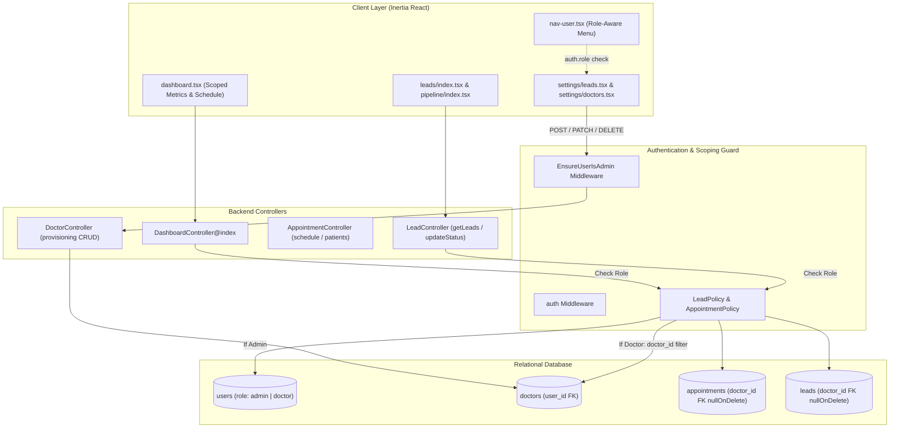

# Single-Clinic Role-Based Access Control (RBAC) & Doctor Data Isolation

* **Author:** allwyn46
* **Status:** Draft
* **Date:** 2026-11-10

--------------------------------------------------------------------------------

## Overview

MediPro operates as a clinic CRM and appointment booking system. Currently, all staff share a single administrative view with unpartitioned access to revenue figures, patient records, and daily schedules. This design establishes a two-tier Role-Based Access Control (RBAC) architecture separating **Clinic Administrators** from **Assigned Doctors**, backed by relational `doctor_id` foreign key scoping across all patient and appointment data.

1. **Admin Role (`role: admin`)**: Retains complete clinic-wide oversight. Admins view global clinic revenue, aggregate patient schedules, the clinic-wide lead pipeline, manage custom intake fields (`/settings/leads`), and provision doctor user accounts.
2. **Doctor Role (`role: doctor`)**: Scoped exclusively to assigned clinical workflows. Doctors log in with individual credentials and view only their assigned appointments, their assigned patient leads, their individual consultation revenue, and their clinical notes.
3. **Doctor Entity Model**: Dedicated `doctors` relational table linked 1-to-1 with `users` (`user_id`), storing clinical specialty, contact details, consultation fee, and active status.
4. **Relational Scoping**: Replaces legacy plain-text `doctor` strings with foreign key `doctor_id` on both `appointments` and `leads` tables (`nullOnDelete` to preserve historical records).

## The Problem

Currently, MediPro operates with a single global user account (`admin@medipro.com`). Every logged-in user can view all clinic financial metrics, browse and reassign any patient lead, confirm or cancel appointments for any physician, and alter system-wide settings. 

In a multi-doctor medical practice, this model presents significant operational and privacy failures:
* **Physician Data Privacy**: Individual doctors should not inspect the earnings, patient notes, or schedule details of their peer physicians.
* **Operational Clutter**: A specialist currently navigates through the entire clinic's daily appointments and pipeline leads to locate their own patients.
* **Administrative Governance**: Clinicians should not have access to form customization or doctor account management settings.
* **Audit & Accountability**: All consultation notes and status updates currently record the generic admin user or an unauthenticated string rather than a cryptographically verified staff session.

## Goals

* **G1: Two-Tier Role Authentication**: Introduce explicit role assignment on the `users` table (`admin` and `doctor`) to govern system capabilities and workspace presentation.
* **G2: Dedicated Doctor Entity**: Establish a `doctors` database table linked to `users` via `user_id`, capturing physician metadata (name, specialty, contact details, consultation fee, active status).
* **G3: Strict Doctor Data Isolation**:
  * Scope dashboard financial cards (`Total Revenue`), consultation metrics (`New Appointments`), and pipeline stats (`Active Patient Leads`) strictly to the authenticated doctor's assigned records.
  * Restrict `/leads` and `/pipeline` views so doctors inspect and modify only leads assigned to their `doctor_id`.
  * Restrict the appointment confirmation queue and daily schedule table to the doctor's assigned bookings.
* **G4: Administrative Exclusivity**:
  * Protect `/settings/*` (including lead form customization) and doctor management endpoints behind an `EnsureUserIsAdmin` middleware.
  * Conditionally suppress Settings navigation links in `nav-user.tsx` for doctor accounts.
* **G5: Unassigned Lead & Booking Triage**: Ensure patient inquiries with `doctor_id = null` remain visible exclusively to Admins with an "Unassigned Specialist" badge for administrative triage.
* **G6: Historical Record Preservation**: Use `nullOnDelete()` on foreign key constraints to ensure physician deactivations or removals never purge past clinical notes or financial transaction history.
* **G7: Dynamic Selector Binding**: Expose active database doctors to public and internal appointment booking dialogs, replacing hardcoded static lists.

## Non-Goals

* **NG1: Multi-Organization / Multi-Clinic Tenancy**: This system is designed for a single medical clinic with multiple doctors. Multi-clinic SaaS tenancy (with isolated schemas or company identifiers) is out of scope.
* **NG2: Patient Self-Service Portals**: Patients remain guest bookers without authenticated user accounts.
* **NG3: Complex Hierarchical Permission Matrix**: Granular per-action permission checkboxes (e.g. nurse vs receptionist vs billing clerk) are excluded; authorization follows the deterministic two-tier `Admin` vs `Doctor` model.

## Open Questions

* **Q1: Cross-Specialist Consultation Transfers**: When a doctor determines that a patient requires treatment by a different specialist (e.g. General Care referring to Orthodontics), should the doctor have permission to reassign `doctor_id` directly, or must reassignments be triaged by an Administrator?
* **Q2: Historical Consultation Fee Immutability**: When calculating doctor revenue from past `Won` leads, should the system sum historical lead `value` snapshot amounts or multiply completed consultations by the doctor's current `consultation_fee`? *(Current plan: sum historical lead `value`).*

## Critical User Journeys (CUJs)

### CUJ 1: Doctor Logs In to Scoped Clinical Dashboard
* **Given**: Dr. Eddie Lake logs in using his assigned doctor credentials.
* **When**: He arrives at the dashboard (`/dashboard`).
* **Then**: The greeting displays "Welcome back, Dr. Eddie Lake!". The Total Revenue card calculates only his consultation earnings (`₹36,000`), the schedule table lists only his appointments, and Settings is absent from his user menu.

### CUJ 2: Doctor Updates Assigned Patient Lead
* **Given**: Dr. Eddie Lake opens `/leads` and selects an assigned patient.
* **When**: He marks the consultation as "Won" with an updated value of `₹5,000`.
* **Then**: The backend verifies his `doctor_id` ownership, updates the record, logs an activity entry authored by Dr. Eddie Lake, and reflects the updated earnings in his dashboard metrics.

### CUJ 3: Doctor Attempts Cross-Doctor Access
* **Given**: Dr. Eddie Lake attempts to view a lead assigned to Dr. Jamik Tashpulatov (`/leads/12`) or search patients outside his clinical scope.
* **When**: The HTTP request hits `LeadPolicy` or `AppointmentController::patients`.
* **Then**: The system denies the request with an HTTP 403 Forbidden error, preventing cross-doctor patient data exposure.

### CUJ 4: Admin Manages Clinic-Wide Operations & Triage
* **Given**: Clinic Administrator logs into `/dashboard`.
* **When**: An unassigned patient appointment is booked online (`doctor_id = null`).
* **Then**: The Admin sees the appointment flagged as "Unassigned Specialist", assigns Dr. Sarah Jenkins, and the record immediately appears in Dr. Jenkins's scoped schedule.


--------------------------------------------------------------------------------

## Technical Plan (Architecture)

### Architectural Overview

The solution establishes a two-tier Role-Based Access Control (RBAC) model operating on top of a single database schema. Authorization is enforced across three defensive layers:
1. **Route Middleware Layer (`EnsureUserIsAdmin`)**: Restricts administrative routes (`/settings/*`, `/api/settings/*`, `/api/doctors/*`, `/api/appointments/reset-demo`) to accounts with `role === 'admin'`.
2. **Policy Enforcement Layer (`LeadPolicy`, `AppointmentPolicy`)**: Validates record-level ownership on single-resource operations (`/leads/{id}`, status changes, appointment confirmations), denying unauthorized cross-doctor operations with HTTP 403 Forbidden.
3. **Query Scoping Layer (Eloquent & Controller)**: Automatically filters collection endpoints and metric aggregations based on the authenticated user's role:
   - For `admin`: queries retrieve unconstrained global clinic datasets.
   - For `doctor`: queries apply a deterministic `where('doctor_id', $user->doctor->id)` constraint.



### 1. Database Schema & Data Modeling

#### 1.1 `users` Table Modification
Adds `role` column to govern top-level permissions.

```php
Schema::table('users', function (Blueprint $table) {
    $table->string('role')->default('doctor')->after('password')->index();
});
```

Model helper methods on `app/Models/User.php`:
```php
public function isAdmin(): bool
{
    return $this->role === 'admin';
}

public function isDoctor(): bool
{
    return $this->role === 'doctor';
}

public function doctor(): HasOne
{
    return $this->hasOne(Doctor::class);
}
```

#### 1.2 `doctors` Relational Table Creation
Stores clinician profiles linked 1-to-1 with a user authentication account.

```php
Schema::create('doctors', function (Blueprint $table) {
    $table->id();
    $table->foreignId('user_id')->unique()->constrained('users')->cascadeOnDelete();
    $table->string('name');
    $table->string('specialty');
    $table->string('phone')->nullable();
    $table->string('email')->unique();
    $table->decimal('consultation_fee', 10, 2)->default(1500.00);
    $table->string('room')->nullable();
    $table->boolean('is_active')->default(true);
    $table->timestamps();

    $table->index('is_active');
    $table->index('specialty');
});
```

#### 1.3 `appointments` & `leads` Relational Updates
Adds indexed foreign keys referencing `doctors.id` with `nullOnDelete()`.

```php
Schema::table('appointments', function (Blueprint $table) {
    $table->foreignId('doctor_id')
        ->nullable()
        ->after('service')
        ->constrained('doctors')
        ->nullOnDelete();
    
    $table->index('doctor_id');
});

Schema::table('leads', function (Blueprint $table) {
    $table->foreignId('doctor_id')
        ->nullable()
        ->after('payment_status')
        ->constrained('doctors')
        ->nullOnDelete();

    $table->index('doctor_id');
});
```

#### 1.4 Seeding & Backfill Script
A dedicated database seeder (`DoctorSeeder`):
1. Ensures `admin@medipro.com` has `role = 'admin'`.
2. Creates `User` records with `role = 'doctor'` and password `'password'` for:
   - Dr. Eddie Lake (`eddie.lake@medipro.com`, Cosmetic & Implant Surgeon)
   - Dr. Jamik Tashpulatov (`jamik.tashpulatov@medipro.com`, Orthodontist Specialist)
   - Dr. Emily Whalen (`emily.whalen@medipro.com`, Cardiologist & Physician)
   - Dr. Sarah Jenkins (`sarah.jenkins@medipro.com`, General Dental Practitioner)
3. Creates corresponding `Doctor` records linked via `user_id`.
4. Executes relational backfill:
   ```php
   foreach (Doctor::all() as $doctor) {
       Appointment::where('doctor', $doctor->name)->update(['doctor_id' => $doctor->id]);
       Lead::where('doctor', $doctor->name)->update(['doctor_id' => $doctor->id]);
   }
   ```

### 2. Authorization & Middleware Architecture

#### 2.1 `EnsureUserIsAdmin` Middleware
Guards administrative routes.
* Path: `app/Http/Middleware/EnsureUserIsAdmin.php`
* Execution:
  ```php
  public function handle(Request $request, Closure $next): Response
  {
      if (! $request->user() || ! $request->user()->isAdmin()) {
          abort(403, 'Unauthorized. Administrative credentials required.');
      }
      return $next($request);
  }
  ```

#### 2.2 Policies (`LeadPolicy` & `AppointmentPolicy`)
* `LeadPolicy`:
  * `view(User $user, Lead $lead)`: Returns `true` if `$user->isAdmin()` or `$lead->doctor_id === $user->doctor?->id`.
  * `update(User $user, Lead $lead)`: Same ownership check.
* `AppointmentPolicy`:
  * `view(User $user, Appointment $app)`: Returns `true` if `$user->isAdmin()` or `$app->doctor_id === $user->doctor?->id`.
  * `confirm(User $user, Appointment $app)`: Same ownership check.
  * `decline(User $user, Appointment $app)`: Same ownership check.

### 3. Controller Scoping Specifications

#### 3.1 `DashboardController@index`
* **Admin**:
  * Total Revenue: `SUM(value)` on `Won` leads across entire clinic.
  * New Appointments: Total count for today.
  * Active Patient Leads: Total un-won/un-lost leads count.
  * Daily Schedule & Confirmation Queue: All clinic appointments.
* **Doctor**:
  * Scoped to `$doctorId = $user->doctor->id`.
  * Total Revenue: `SUM(value)` on `Won` leads `WHERE doctor_id = $doctorId`.
  * New Appointments: Count of today's appointments `WHERE doctor_id = $doctorId`.
  * Active Patient Leads: Count of leads `WHERE doctor_id = $doctorId`.
  * Daily Schedule: Appointments `WHERE doctor_id = $doctorId`.
  * Confirmation Queue: Incoming bookings `WHERE doctor_id = $doctorId`.

#### 3.2 `LeadController`
* `getLeads(?User $user = null)`:
  * If `$user?->isDoctor()`: `Lead::with('activities')->where('doctor_id', $user->doctor->id)->orderBy('id')->get()`.
  * Else: `Lead::with('activities')->orderBy('id')->get()`.
* `show($id)`: Calls `$this->authorize('view', $lead)`.
* `updateStatus($id)`: Calls `$this->authorize('update', $lead)`.
* `addNote($id)`: Calls `$this->authorize('update', $lead)`.

#### 3.3 `PipelineController@index`
* Renders Kanban board passing leads filtered by the user's role.

#### 3.4 `AppointmentController@patients`
* Scoped so that a doctor searches only patients who have existing leads or appointments with their `doctor_id`.

#### 3.5 `DoctorController` (Admin Management Endpoints)
* `GET /settings/doctors`: Renders Inertia doctor directory view.
* `POST /api/doctors`: Creates `User` (`role: doctor`) and `Doctor` profile.
* `PATCH /api/doctors/{id}`: Updates contact info, consultation fee, or room.
* `DELETE /api/doctors/{id}`: Soft deactivates (`is_active = false`).

### 4. Frontend Component & Layout Integration

#### 4.1 Inertia Shared Authentication Props
In `app/Http/Middleware/HandleInertiaRequests.php`:
```php
'auth' => [
    'user' => $request->user() ? [
        'id' => $request->user()->id,
        'name' => $request->user()->name,
        'email' => $request->user()->email,
        'role' => $request->user()->role,
    ] : null,
    'doctor' => $request->user()?->doctor ? [
        'id' => $request->user()->doctor->id,
        'name' => $request->user()->doctor->name,
        'specialty' => $request->user()->doctor->specialty,
        'consultation_fee' => $request->user()->doctor->consultation_fee,
    ] : null,
],
```

#### 4.2 Dynamic User Menu (`resources/js/components/nav-user.tsx`)
* Displays authenticated user's name or doctor specialty badge.
* Conditionally suppresses the `Settings` option if `auth.user.role !== 'admin'`.

#### 4.3 Personalized Dashboard (`resources/js/pages/dashboard.tsx`)
* Dynamic header greeting: `"Welcome back, Dr. Eddie Lake!"` vs `"Welcome back, Administrator!"`.
* Localized metric card titles:
  * For doctors: `"My Consultation Revenue"`, `"My Patient Leads"`.
  * For admins: `"Total Clinic Revenue"`, `"Active Patient Leads"`.

#### 4.4 Dynamic Doctor Selectors
* In `book-appointment-dialog.tsx` and `add-lead-dialog.tsx`:
  * Consumes dynamic `doctors` prop from backend rather than hardcoded static arrays.
  * Allows newly provisioned doctors to receive appointments immediately without frontend code changes.


--------------------------------------------------------------------------------

## Alternatives Considered

### Alternative 1: Name-Based String Matching on Existing `doctor` Column
* **Mechanism**: Filter appointments and leads using text matching against the user's name: `where('doctor', auth()->user()->name)`.
* **Pros**:
  * Eliminates the need for creating a new `doctors` table and executing schema migrations for `doctor_id`.
  * Preserves existing query structures without foreign key joins.
* **Cons**:
  * Highly fragile. If an administrator edits a physician's name (e.g. correcting a typo or updating a title), historical records become immediately disconnected.
  * Collisions occur if two physicians share a common name.
  * String filtering prevents database index optimization and foreign key integrity cascades.
* **Reason for Rejection**: `Rejected by author: Foreign key integrity with doctor_id is strictly required for data isolation, reliable physician profile updates, and query indexing performance.`

### Alternative 2: Multi-Tenant Database/Schema Separation (Schema per Doctor)
* **Mechanism**: Allocate isolated database schemas or SQLite database files per physician, switching database connections dynamically at request runtime.
* **Pros**:
  * Complete physical data segregation at the database level.
* **Cons**:
  * Severe architectural overhead. Requires managing connection pools, cross-database migrations, and dynamic tenant resolution.
  * Breaks clinic-wide administrative rollups. The clinic administrator would need complex federated queries across multiple database instances to calculate total clinic revenue or schedule staff.
  * Over-engineered for a single physical clinic.
* **Reason for Rejection**: `Rejected by author: MediPro is a single clinic where physicians collaborate under unified administration. Row-level foreign key scoping cleanly achieves complete privacy without infrastructure fragmentation.`

### Alternative 3: External Permissions Package (e.g., Spatie Laravel Permission)
* **Mechanism**: Install `spatie/laravel-permission` to define roles (`admin`, `doctor`) and assign fine-grained permission nodes (e.g., `view-own-leads`, `edit-appointments`).
* **Pros**:
  * Provides out-of-the-box UI permission checkers and dynamic database-driven permission assignment.
* **Cons**:
  * Introduces unnecessary package weight and extra database tables (`roles`, `permissions`, `model_has_roles`, `role_has_permissions`).
  * Excessive for a deterministic two-tier role system (`admin` vs `doctor`) where permissions are fixed and data scoping is strictly relational.
* **Reason for Rejection**: `Rejected by author: Native Laravel Gates, Policies, and Middleware provide cleaner, faster execution without external package bloat.`


--------------------------------------------------------------------------------

## Non-Functional Requirements

### 1. Security & Privacy
* **Defense in Depth**: Authorization checks must occur at the Route middleware level (`EnsureUserIsAdmin`), Controller query level (`where('doctor_id', ...)`), and Policy gate level (`authorize('view', $lead)`).
* **Zero Patient Data Leakage**: The patient search lookup endpoint (`GET /api/patients`) must never expose patients of Doctor A to Doctor B.
* **Credential Protection**: Passwords generated for doctors during provisioning must be hashed with Bcrypt/Argon2. Doctor account creation must be restricted to authenticated administrative sessions.
* **Strict HTTP 403 Enforcement**: Unauthorized attempts by doctors to query or mutate records assigned to other clinicians must abort with standard HTTP 403 Forbidden without disclosing clinical details.

### 2. Performance & Scalability
* **Indexed Relational Lookups**: The `doctor_id` column on both `appointments` and `leads` tables must be indexed.
* **Single-Query Dashboard Aggregation**: Doctor dashboard metric cards (revenue, appointments count, leads count) must execute as optimized SQL aggregates (`SUM(value)`, `COUNT(*)`) scoped by `doctor_id` rather than loading entire collections into PHP memory.

### 3. Rollout & Backward Compatibility
* **Foreign Key Nullability**: The `doctor_id` column on `appointments` and `leads` is created as `nullable()`, ensuring seamless backward compatibility with unassigned leads.
* **Data Migration & Backfill**: An automated seeder/backfill migration matches existing doctor string names against seeded doctor records, ensuring zero data disconnection during rollout.
* **Preservation on Deletion (`nullOnDelete`)**: Doctor deactivation or deletion sets `doctor_id` to `NULL`, preventing cascade deletion of past financial transaction logs or clinical consultation history.

--------------------------------------------------------------------------------

## Detailed Implementation Plan

### Target Files to Create & Modify

#### 1. `database/migrations/YYYY_MM_DD_HHMMSS_add_role_to_users_table.php` (Create)
* **Scope**: Database Migration
* **Rationale**: Adds an indexed `role` string column (`admin`, `doctor`) with a default value of `'doctor'` to the `users` table.

#### 2. `database/migrations/YYYY_MM_DD_HHMMSS_create_doctors_table.php` (Create)
* **Scope**: Database Migration
* **Rationale**: Creates the `doctors` table linked to `users` via a unique `user_id` foreign key with `cascadeOnDelete()`, storing `name`, `specialty`, `phone`, `email`, `consultation_fee`, `room`, and `is_active`.

#### 3. `database/migrations/YYYY_MM_DD_HHMMSS_add_doctor_id_to_appointments_and_leads_tables.php` (Create)
* **Scope**: Database Migration
* **Rationale**: Adds an indexed `doctor_id` foreign key referencing `doctors.id` with `nullOnDelete()` to both `appointments` and `leads` tables.

#### 4. `database/seeders/DoctorSeeder.php` (Create)
* **Scope**: Database Seeder
* **Rationale**: Ensures `admin@medipro.com` is configured with `role = 'admin'`, creates `User` credentials and `Doctor` profiles for existing clinicians (`Dr. Eddie Lake`, `Dr. Jamik Tashpulatov`, `Dr. Emily Whalen`, `Dr. Sarah Jenkins`), and backfills `doctor_id` across historical appointment and lead records.

#### 5. `app/Models/Doctor.php` (Create)
* **Scope**: Eloquent Model
* **Rationale**: Encapsulates doctor profile data access with relationships to `User` (`belongsTo`), `Appointment` (`hasMany`), `Lead` (`hasMany`), and an `active()` query scope.

#### 6. `app/Models/User.php` (Modify)
* **Scope**: Eloquent Model
* **Rationale**: Adds `doctor()` (`hasOne`) relationship, and declares helper methods `isAdmin(): bool` and `isDoctor(): bool`.

#### 7. `app/Models/Appointment.php` (Modify)
* **Scope**: Eloquent Model
* **Rationale**: Defines `doctorProfile()` (`belongsTo`) relationship and establishes a fallback accessor for the legacy `doctor` string attribute.

#### 8. `app/Models/Lead.php` (Modify)
* **Scope**: Eloquent Model
* **Rationale**: Defines `doctorProfile()` (`belongsTo`) relationship and establishes a fallback accessor for the legacy `doctor` string attribute.

#### 9. `app/Http/Middleware/EnsureUserIsAdmin.php` (Create)
* **Scope**: HTTP Middleware
* **Rationale**: Guards administrative routes by checking `$request->user()->isAdmin()`, aborting with HTTP 403 Forbidden for unauthorized requests.

#### 10. `bootstrap/app.php` (Modify)
* **Scope**: Application Configuration
* **Rationale**: Registers the `admin` middleware alias (`EnsureUserIsAdmin`) in the Laravel 11 application middleware pipeline.

#### 11. `app/Policies/LeadPolicy.php` (Create)
* **Scope**: Authorization Policy
* **Rationale**: Restricts `view`, `update`, and `addNote` actions on a lead to Admins or the doctor whose `doctor_id` matches the lead.

#### 12. `app/Policies/AppointmentPolicy.php` (Create)
* **Scope**: Authorization Policy
* **Rationale**: Restricts `view`, `confirm`, and `decline` actions on an appointment to Admins or the doctor whose `doctor_id` matches the appointment.

#### 13. `app/Http/Controllers/DashboardController.php` (Modify)
* **Scope**: Backend Controller
* **Rationale**: Scopes metrics cards (Revenue, Appointments, Leads) and the daily appointments schedule table based on the authenticated user's role.

#### 14. `app/Http/Controllers/LeadController.php` (Modify)
* **Scope**: Backend Controller
* **Rationale**: Updates `getLeads()` to apply `where('doctor_id', ...)` for doctors, and enforces `LeadPolicy` checks in `show()`, `updateStatus()`, and `addNote()`.

#### 15. `app/Http/Controllers/PipelineController.php` (Modify)
* **Scope**: Backend Controller
* **Rationale**: Filters pipeline leads by `doctor_id` when viewed by a doctor.

#### 16. `app/Http/Controllers/AppointmentController.php` (Modify)
* **Scope**: Backend Controller
* **Rationale**: Scopes `patients()` search query to only return patients assigned to the doctor, and enforces `AppointmentPolicy` in `confirm()` and `decline()`.

#### 17. `app/Http/Controllers/DoctorController.php` (Create)
* **Scope**: Backend Controller
* **Rationale**: Admin controller implementing CRUD endpoints to list, provision, update, and deactivate doctor accounts (`GET /settings/doctors`, `POST /api/doctors`, `PATCH /api/doctors/{id}`, `DELETE /api/doctors/{id}`).

#### 18. `routes/web.php` (Modify)
* **Scope**: Routing Configuration
* **Rationale**: Secures `/settings/*`, `/api/settings/*`, `/api/appointments/reset-demo`, and doctor management endpoints behind `admin` middleware. Registers doctor management routes.

#### 19. `app/Http/Middleware/HandleInertiaRequests.php` (Modify)
* **Scope**: Inertia Shared Data Middleware
* **Rationale**: Shares `auth.user`, `auth.doctor`, `auth.role`, and active clinic doctors in global Inertia props for client-side rendering.

#### 20. `resources/js/components/nav-user.tsx` (Modify)
* **Scope**: Sidebar Component
* **Rationale**: Conditionally hides the `Settings` menu item when `auth.role !== 'admin'`, and displays doctor specialty role.

#### 21. `resources/js/pages/dashboard.tsx` (Modify)
* **Scope**: Frontend React View
* **Rationale**: Renders personalized greetings, localized metric card titles ("My Consultation Revenue" vs "Total Clinic Revenue"), and shows "Unassigned Specialist" badge for unassigned items in Admin view.

#### 22. `resources/js/components/book-appointment-dialog.tsx` (Modify)
* **Scope**: Frontend Modal Component
* **Rationale**: Dynamically renders doctor options from shared active database doctors rather than hardcoded static arrays.

#### 23. `resources/js/components/add-lead-dialog.tsx` (Modify)
* **Scope**: Frontend Modal Component
* **Rationale**: Dynamically renders doctor options from shared active database doctors rather than hardcoded static arrays.

#### 24. `resources/js/pages/settings/doctors.tsx` (Create)
* **Scope**: Frontend React View (Inertia)
* **Rationale**: Admin view to manage doctor directory, create doctor accounts with email/password and specialty, adjust consultation fees, and toggle active status.

#### 25. `tests/Feature/DoctorScopingTest.php` (Create)
* **Scope**: Pest Feature Test Suite
* **Rationale**: Comprehensive test coverage verifying doctor workspace data isolation, 403 Forbidden enforcement on cross-doctor operations, admin oversight across all records, and admin-only settings route protection.
