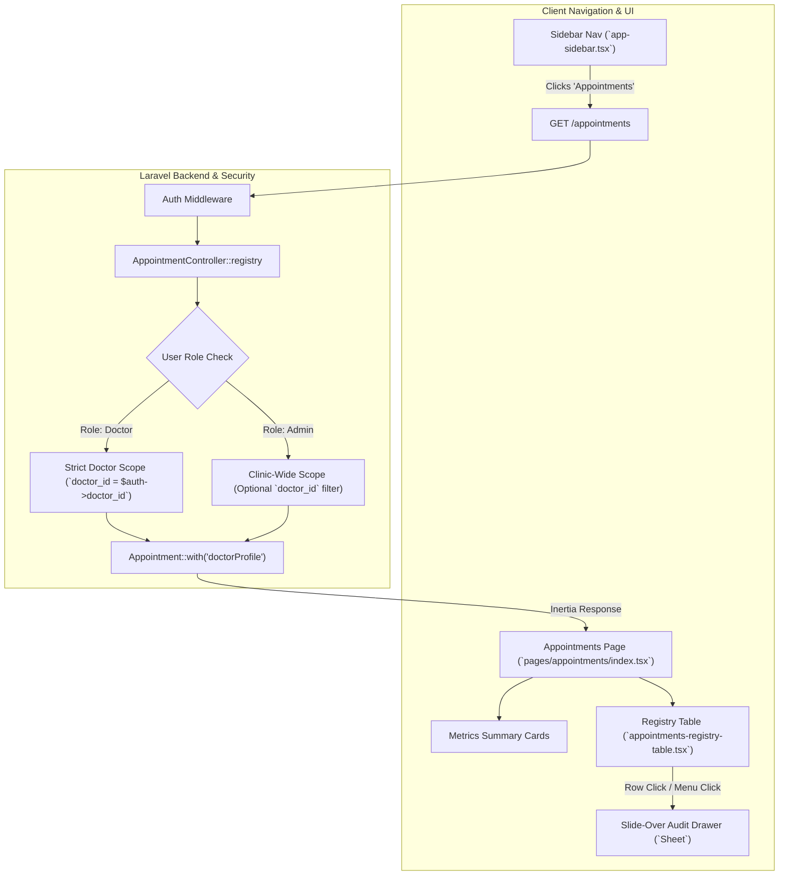

# Dedicated Appointments Navigation & Advanced Schedule Filtering

* **Author:** allwyn46
* **Status:** Approved
* **Date:** 2026-11-13

---

## Overview

Clinical staff and specialists require a dedicated workspace to audit, search, and filter patient consultations and procedures across any timeframe and lifecycle status. The current application embeds appointments directly on the main dashboard alongside billing KPIs, restricting schedule filtering to simple search strings, doctor selection, and single-day tabs (Today/Tomorrow).

This design introduces an "Appointments" navigation item directly below "Leads" in the primary sidebar, leading to a full-screen appointments registry (`/appointments`). The registry provides multi-status selection (enabling simultaneous filtering across statuses such as `Confirmed`, `Pending`, `Awaiting Confirmation`, and `Reschedule`), dual-layer date filtering (combining quick preset pills with a custom date-range selector), and strict role-based doctor scoping so specialists only view their assigned appointments while administrators retain clinic-wide visibility. The existing dashboard appointment schedule remains unchanged for daily front-desk triage.

---

## The Problem

1. **Dashboard Congestion**: The dashboard is designed for high-level daily operations (incoming portal booking triage and today's schedule). Using it as an operational query registry for historical audits or multi-week planning forces compromises between summary metrics and deep data tables.
2. **Coarse Status & Date Filtering**: Staff cannot isolate multi-status cohorts simultaneously (e.g., viewing `Pending` portal bookings alongside `Awaiting Confirmation` staff bookings). Date selection on the dashboard is restricted to single-day pills (`Today`, `Tomorrow`), preventing cross-week or monthly scheduling audits.
3. **Absence of Dedicated Registry Route**: Staff navigating directly to appointments currently have no distinct URL (`/appointments`) to bookmark or return to.

---

## Goals

* **Dedicated Navigation & Route**: Add an "Appointments" sidebar item below "Leads" linking to a dedicated Inertia route (`GET /appointments`) using standard clinic `Layout`.
* **Multi-Status Filtering**: Allow clinical users to filter across multiple appointment statuses simultaneously using a faceted popover selector with quick clinical macros ("Needs Action", "Active Schedule").
* **Dual-Layer Date Filtering**: Provide instant preset filters (`All`, `Today`, `Tomorrow`, `This Week`, `This Month`) paired with a custom calendar date-range picker (`From` and `To` dates).
* **Strict Role-Based Scoping**: Enforce at the controller layer that doctors view only their own assigned appointments (`doctor_id`), while administrators view clinic-wide records with an optional specialist selector.
* **Date Normalization**: Normalize textual dates (`'Today'`, `'Tomorrow'`, `'Nov 6'`) to ISO date strings (`YYYY-MM-DD`) on the client to ensure interval comparisons evaluate accurately.
* **Non-Mutating Audit Drawer**: Provide a slide-over inspection drawer (`Sheet`) to view timestamps, confirmation tokens, clinical notes, and lead navigation without adding accidental mutating row actions.
* **Automated Test Coverage**: Write comprehensive Pest feature tests verifying authentication boundaries, doctor scoping, admin specialist filtering, and query integrity.

---

## Non-Goals

* **Dashboard Table Modification**: The existing dashboard appointments table and confirmation triage card will not be removed or redesigned.
* **Direct Row Mutations**: No inline status mutations (marking completed, cancelling, checking in) will be exposed directly on registry table rows.
* **Calendar Grid Views**: Interactive monthly/weekly visual grid calendars (e.g., FullCalendar) are out of scope; the feature focuses strictly on tabular data filtering.
* **Third-Party Calendar Integrations**: Syncing with Google Calendar, Outlook, or Apple iCal is out of scope.

---

## Open Questions

* None. Architectural boundaries, role-based scoping invariants, and read-only drawer mechanics were resolved during brainstorming.

---

## Critical User Journeys (CUJs)

### CUJ 1: Clinic Admin Auditing Unconfirmed Bookings Across the Week
* **Given**: An authenticated clinic administrator is logged into MediPro.
* **When**: The admin clicks "Appointments" in the sidebar, selects the "This Week" date preset, and enables the "Needs Action" macro (selecting `Pending` and `Awaiting Confirmation`).
* **Then**: The table updates immediately to display all unconfirmed clinic bookings for the current week. Clicking an appointment row opens the slide-over inspection drawer showing patient details, booking timestamps, and a link to the CRM lead profile.

### CUJ 2: Specialist Doctor Reviewing Monthly Consultation Roster
* **Given**: An authenticated doctor (e.g. Dr. Eddie Lake) is logged into MediPro.
* **When**: The doctor clicks "Appointments" in the sidebar and selects the "This Month" date preset.
* **Then**: The system displays only appointments assigned to Dr. Eddie Lake. Any attempt to supply another doctor's ID via query parameters is ignored by the backend. The specialist selector dropdown is completely hidden from the view.

### CUJ 3: Staff Performing Custom Date Range Search
* **Given**: An authenticated staff user visits `/appointments`.
* **When**: The user specifies `2026-11-01` in the "From" input and `2026-11-15` in the "To" input, and types "Implant" into the search field.
* **Then**: The table displays all appointments between November 1 and November 15 where the procedure or patient notes contain "Implant", accurately including normalized relative date records.

---

## Technical Plan (Architecture)

### Architectural Components & System Topology

The feature introduces a dedicated `/appointments` registry while preserving existing dashboard operations. The system topology separates routing, backend security scoping, client-side table filtering, and record inspection into distinct layers:



### 1. Routing & Security Scoping (`app/Http/Controllers/AppointmentController.php`)

To avoid collision with the existing `index(): JsonResponse` method, a dedicated method `registry(Request $request): \Inertia\Response` is created.

* **Security Invariant**:
  If the authenticated user has the `doctor` role, the query strictly enforces their doctor profile ID. Any user-supplied query string parameter (such as `?doctor_id=99`) is explicitly ignored for doctor accounts to prevent horizontal privilege escalation.
* **Administrator Privileges**:
  Admins receive clinic-wide records by default and are supplied an active doctor directory to filter the view by specialist if desired.

```php
public function registry(Request $request): \Inertia\Response
{
    $user = $request->user();
    $isDoctor = $user && $user->isDoctor();
    $isAdmin = $user && $user->isAdmin();

    $query = Appointment::query()
        ->with(['doctorProfile'])
        ->orderByDesc('id');

    if ($isDoctor) {
        $doctorId = $user->doctor?->id;
        $query->where(function ($q) use ($doctorId, $user) {
            $q->where('doctor_id', $doctorId);
            if ($user->doctor?->name) {
                $q->orWhere('doctor', $user->doctor->name);
            }
        });
    } elseif ($isAdmin && $request->filled('doctor_id')) {
        $query->where('doctor_id', (int) $request->query('doctor_id'));
    }

    $appointments = $query->get();
    $doctors = $isAdmin 
        ? Doctor::active()->orderBy('name')->get(['id', 'name', 'specialty']) 
        : [];

    return Inertia::render('appointments/index', [
        'appointments' => $appointments,
        'doctors' => $doctors,
        'isAdmin' => $isAdmin,
        'selectedDoctorId' => $isAdmin && $request->filled('doctor_id') ? (int) $request->query('doctor_id') : null,
    ]);
}
```

### 2. Date Normalization Pipeline

Because appointment dates in the database contain both standard ISO dates (`2026-11-20`) and human/relative strings (`Today`, `Tomorrow`, `Nov 6`), comparing dates directly against range bounds (`dateFrom` and `dateTo`) causes false negatives. 

A client-side normalizer utility mirrors the backend `Appointment::getScheduledDate()` logic:

```typescript
export function normalizeAppointmentDate(dateStr?: string | null): string {
    if (!dateStr) return "";
    const clean = dateStr.trim().toLowerCase();
    const today = new Date();
    
    if (clean === "today") {
        return today.toISOString().split("T")[0];
    }
    if (clean === "tomorrow") {
        const tomorrow = new Date(today);
        tomorrow.setDate(tomorrow.getDate() + 1);
        return tomorrow.toISOString().split("T")[0];
    }
    
    const parsed = new Date(dateStr);
    if (!isNaN(parsed.getTime())) {
        return parsed.toISOString().split("T")[0];
    }
    return dateStr;
}
```

### 3. Multi-Status Filtering Architecture

Instead of single-select dropdowns, status filtering implements a faceted popover containing checkboxes for each available status:
* `Confirmed`
* `In Progress`
* `Scheduled`
* `Completed`
* `Pending`
* `Awaiting Confirmation`
* `Cancelled`
* `Reschedule`

The popover provides two clinical macro buttons:
* **"Needs Action"**: Auto-checks `Pending` and `Awaiting Confirmation` to surface unreviewed or unconfirmed visits immediately.
* **"Active Schedule"**: Auto-checks `Confirmed`, `In Progress`, and `Scheduled` to view upcoming clinical visits.

When active, the filter trigger button displays an indicator badge with the selected count (e.g., `Status (3)`) and a one-click "Clear" button.

### 4. Dual-Layer Date Filtering Architecture

The date filtering toolbar provides two complementary layers:
* **Quick Presets**: Pill button group: `[ All ]`, `[ Today ]`, `[ Tomorrow ]`, `[ This Week ]`, `[ This Month ]`.
* **Custom Date Range**: Dual date picker inputs (`From` and `To`). Setting custom dates highlights a "Custom" badge and updates the table row filter predicate. Clicking a preset pill clears the custom range inputs; picking custom dates deselects the preset pills.

### 5. Slide-Over Audit Drawer (`Sheet`)

Since direct row mutations are strictly excluded, clicking an appointment row or selecting "View Audit Details" opens a slide-over `Sheet` component displaying:
* Full patient name, phone number, and email.
* Clinical procedure, assigned doctor, suite/room, and duration.
* Complete timestamps: `created_at`, `requested_at`, and `reminder_sent_at`.
* Token confirmation states (`patient_confirmed_at`, `doctor_confirmed_at`).
* Clinical patient notes and internal booking observations.
* Direct navigational link to the patient's lead profile (`/leads/{leadId}`).

---

## Alternatives Considered

### Alternative A: Overloading `AppointmentController::index` via Content Negotiation

* **Pros**: Reuses the existing `/api/appointments` route name and controller action without introducing a new method.
* **Cons**: Content negotiation (`$request->wantsJson()`) is brittle. Page refreshes, third-party extensions, or client-side fetch requests with varying `Accept` headers can mistakenly receive raw JSON payloads instead of an Inertia view, or vice versa.
* **Reason for Rejection**: Rejected by author: Content negotiation on a shared endpoint creates fragile state and hard-to-debug edge cases. An explicit, dedicated controller action (`AppointmentController::registry`) maintains strict separation between JSON APIs and Inertia page routes.

### Alternative B: Inline Status Mutation Actions on Registry Rows

* **Pros**: Allows staff to quickly mark appointments as completed or cancelled directly within the table.
* **Cons**: Creates a high risk of accidental status changes during routine audits and schedule exploration. It also duplicates the operational triage responsibilities of the dashboard.
* **Reason for Rejection**: Rejected by author: The `/appointments` page serves as an authoritative historical and future audit ledger. Excluding direct row mutations preserves data integrity during high-volume schedule audits, while the slide-over drawer provides necessary inspection context.

### Alternative C: Removing the Appointments Table from the Main Dashboard

* **Pros**: Eliminates having appointments visible in two places in the application.
* **Cons**: Forces front-desk staff to constantly navigate between the dashboard and the registry just to check on today's immediate arrivals or incoming client portal bookings.
* **Reason for Rejection**: Rejected by author: The dashboard must remain an operational hub for immediate daily check-ins and pending booking confirmations. The `/appointments` page acts as a comprehensive analytical registry, allowing both views to serve their distinct operational roles.

### Alternative D: Unnormalized Client-Side Date String Comparisons

* **Pros**: Avoids implementing a client-side date normalizer utility.
* **Cons**: Historical and seeded database rows contain relative strings (`Today`, `Tomorrow`) or short-month strings (`Nov 6`). Comparing these directly against ISO date picker bounds (`2026-11-01` to `2026-11-15`) fails silently, omitting valid appointments from filtered views.
* **Reason for Rejection**: Rejected by author: Date string comparisons without normalization produce inaccurate search and filter results. A dedicated normalizer mirroring the backend Carbon parser guarantees correct interval evaluation across all records.

---

## Detailed Implementation Plan

### Target Files to Create / Modify

#### 1. `resources/js/components/app-sidebar.tsx` (Modify)
* **Type / Scope**: TypeScript / React Sidebar Navigation Component
* **Proposed Changes**:
  * Import `CalendarIcon` from `lucide-react` (if not already imported).
  * Insert a new navigation item in `data.navMain` immediately following `Leads`:
    ```typescript
    {
        title: "Appointments",
        url: "/appointments",
        icon: <CalendarIcon />,
    }
    ```
* **Rationale**: Satisfies the requirement to provide an "Appointments" tab directly below "Leads" in the main sidebar.

#### 2. `routes/web.php` (Modify)
* **Type / Scope**: Laravel Web Routes Configuration
* **Proposed Changes**:
  * Add the registry route inside the authenticated route group (`Route::middleware('auth')->group(...)`):
    ```php
    Route::get('/appointments', [AppointmentController::class, 'registry'])->name('appointments.index');
    ```
* **Rationale**: Registers a dedicated authenticated URL and named route for the appointments registry without disrupting existing API endpoints.

#### 3. `app/Http/Controllers/AppointmentController.php` (Modify)
* **Type / Scope**: Laravel HTTP Controller
* **Proposed Changes**:
  * Add the `registry(Request $request): \Inertia\Response` method.
  * Retrieve authenticated user and evaluate role:
    * If `$user->isDoctor()`: strictly filter `Appointment::query()` by `$user->doctor->id` (and doctor name as fallback). Ignore any input parameter `doctor_id` to prevent unauthorized cross-doctor access.
    * If `$user->isAdmin()`: allow optional filtering by `$request->query('doctor_id')` when provided.
  * Supply active doctors list (`Doctor::active()->orderBy('name')->get(['id', 'name', 'specialty'])`) exclusively to administrators (`isAdmin`).
  * Return Inertia render targeting `appointments/index` with props: `appointments`, `doctors`, `isAdmin`, and `selectedDoctorId`.
* **Rationale**: Enforces backend authorization and security boundaries, avoiding method collision with the existing `index(): JsonResponse` method.

#### 4. `resources/js/pages/appointments/index.tsx` (Create)
* **Type / Scope**: Inertia / React Page Component
* **Proposed Changes**:
  * Define page component wrapped in `Layout` with title "Appointments".
  * Render breadcrumbs and page header ("Appointments Registry" and descriptive subtitle).
  * Render high-level summary cards (Total Appointments, Confirmed Appointments, Needs Action / Pending, Completed Appointments).
  * Render `AppointmentsRegistryTable` passed down with `appointments`, `doctors`, `isAdmin`, and `selectedDoctorId`.
* **Rationale**: Provides the top-level view structure for the dedicated appointments registry.

#### 5. `resources/js/components/appointments-registry-table.tsx` (Create)
* **Type / Scope**: React / TanStack Table UI Component
* **Proposed Changes**:
  * Implement TanStack Table with features: column filtering, row selection, sorting, pagination, and column visibility.
  * Build toolbar containing:
    * Search input for patient name, email, phone, procedure, and notes.
    * Multi-status faceted selection popover with checkboxes for all 8 statuses (`Confirmed`, `In Progress`, `Scheduled`, `Completed`, `Cancelled`, `Pending`, `Awaiting Confirmation`, `Reschedule`) and clinical quick-macros ("Needs Action", "Active Schedule").
    * Dual-layer date filtering:
      * Quick preset pills: `All`, `Today`, `Tomorrow`, `This Week`, `This Month`.
      * Custom date range inputs: `From` and `To` date pickers with clear button.
    * Specialist select dropdown (rendered exclusively for admins when `isAdmin` is true).
    * Column visibility toggle menu (`Columns3Icon`).
  * Define columns: selection checkbox, scheduled date/time, patient name & phone (linked to `/leads/{leadId}`), procedure/service & cabin, specialist name, appointment type badge, status badge, and an audit menu.
  * Implement a slide-over audit drawer (`Sheet`) triggered on row click or "View Audit Details" menu click, displaying:
    * Comprehensive appointment timestamps (`created_at`, `requested_at`, `reminder_sent_at`).
    * Confirmation states for patient and doctor.
    * Clinical notes and internal observations.
    * Direct link to the associated lead in CRM.
* **Rationale**: Delivers the complete operational filtering and auditing interface required by the user while adhering to the read-only constraint.

#### 6. `resources/js/utils/date-normalization.ts` (Create)
* **Type / Scope**: TypeScript Date Utility
* **Proposed Changes**:
  * Implement `normalizeAppointmentDate(dateStr?: string | null): string`:
    * Converts `'Today'` to today's date formatted as `YYYY-MM-DD`.
    * Converts `'Tomorrow'` to tomorrow's date formatted as `YYYY-MM-DD`.
    * Parses human dates (`'Nov 6'`, `'2026-11-20'`) into `YYYY-MM-DD`.
  * Implement date interval predicate helper `isWithinDateRange(dateStr: string, fromDate?: string, toDate?: string): boolean`.
* **Rationale**: Solves the data mismatch between text-based database storage and calendar date-range filtering, preventing false negatives during audits.

#### 7. `tests/Feature/AppointmentsRegistryTest.php` (Create)
* **Type / Scope**: Pest Feature Test Suite
* **Proposed Changes**:
  * `guests are redirected to login when visiting /appointments`.
  * `doctors can access /appointments and only see their assigned appointments`.
  * `doctors cannot view other specialists appointments via query tampering (?doctor_id=...)`.
  * `administrators can view clinic-wide appointments on /appointments`.
  * `administrators can filter appointments by specialist using ?doctor_id=...`.
  * `administrators receive the doctors list prop while doctors receive an empty list`.
  * `visiting /appointments does not mutate any appointment status or lead record`.
* **Rationale**: Guarantees automated regression testing and proves security scoping and contract compliance.

---

### Verification Plan

* **Static Analysis & Type Checking**:
  * Run `npm run types:check` to ensure 0 TypeScript compilation errors across new page, table, and sidebar changes.
* **Code Formatting**:
  * Run `vendor/bin/pint --dirty --format agent` to guarantee PSR-12 code compliance for all modified and created PHP files.
* **Automated Feature Tests**:
  * Run `php artisan test --compact tests/Feature/AppointmentsRegistryTest.php` to verify all 7+ registry test cases pass.
  * Run full test suite `php artisan test --compact` to ensure zero regressions across existing tests.
* **Production Asset Build**:
  * Run `npm run build` to verify clean Vite chunk generation and Wayfinder route synchronization.
