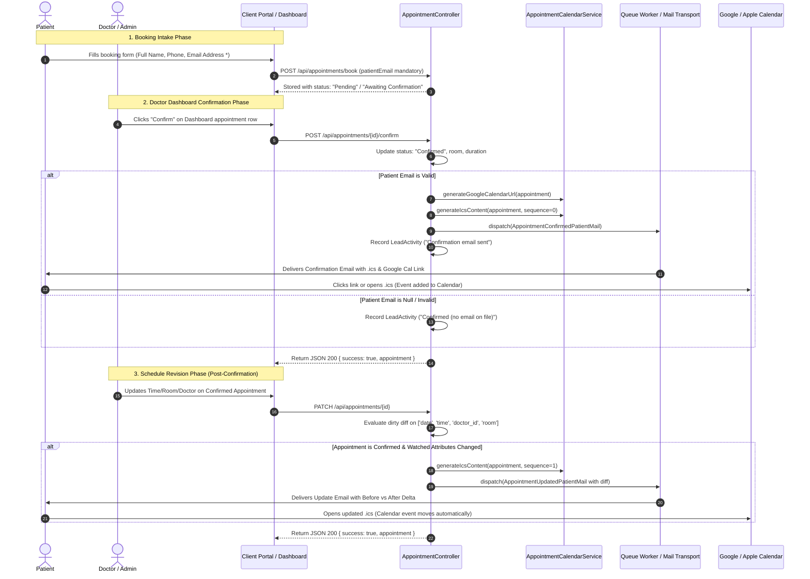

# Patient Confirmation Email & Calendar Integration on Doctor Dashboard Confirmation

*   **Author:** allwyn46
*   **Status:** Proposed
*   **Date:** 2026-11-16

--------------------------------------------------------------------------------

## Overview

When an attending clinician or clinic administrator confirms an appointment directly on the MediPro dashboard or appointments registry, the system immediately queues and dispatches an automated, responsive HTML confirmation email (`AppointmentConfirmedPatientMail`) to the patient. This email provides formal verification of the booked slot, clinic room allocation, specialist details, and 1-click calendar synchronization via Google Calendar web links and RFC 5545 Apple Calendar/Outlook (`.ics`) attachments. 

To ensure reliable delivery, patient email capture is enforced as a required field (`Email Address *`) on the public booking portal, eliminating a pre-existing form validation mismatch. Additionally, if core clinical details (`date`, `time`, `doctor_id`, or `room`) are subsequently modified on an already confirmed appointment, an update notification (`AppointmentUpdatedPatientMail`) is automatically dispatched with an explicit change delta and an updated calendar sequence.

## The Problem

1. **Silent Dashboard Confirmations**: When a doctor confirms an appointment from the dashboard (`POST /api/appointments/{id}/confirm`), the record status changes to `Confirmed` in the database, but no communication is dispatched to the patient. Patients who booked online or over the phone are left without written verification or calendar invites.
2. **Scheduled Dual-Confirmation vs. On-Demand Review Gap**: The existing dual-confirmation reminder email (`AppointmentPatientReminderMail`) only executes on a 1-week advance schedule batch command. Intake consultations or appointments scheduled with shorter lead times bypass this reminder and receive no confirmation notice when accepted by a clinician.
3. **Form Validation Inconsistency in Booking Portal**: The public booking form (`welcome.tsx`) labels the email field as `Email Address (Optional)` without the HTML `required` attribute, but the backend controller (`AppointmentController::store`) requires an email address. Patients who leave the field blank experience a silent 422 HTTP failure.
4. **Calendar Interoperability Friction**: Without standard calendar synchronization, patients must manually transcribe date, time, doctor, and clinic address into their calendars, increasing consultation no-show rates. Furthermore, if an appointment time changes, lack of a deterministic RFC 5545 event identifier causes updated calendar invites to duplicate rather than replace existing events.

## Goals

*   **Enforce Email Capture**: Make patient email strictly mandatory on the public booking form (`resources/js/pages/welcome.tsx`), aligning frontend validation with the backend controller rules.
*   **Automated Confirmation Dispatch**: Immediately queue and dispatch a responsive HTML confirmation email (`AppointmentConfirmedPatientMail`) when a doctor confirms an appointment via `POST /api/appointments/{id}/confirm`.
*   **Universal 1-Click Calendar Sync**: Provide both a Google Calendar web intent link and an RFC 5545 `.ics` calendar attachment with a deterministic `UID` (`medipro-apt-{id}@medipro.com`) and initial `SEQUENCE:0`.
*   **Schedule Revision Notifications**: Dispatch an update notice (`AppointmentUpdatedPatientMail`) with a clear before-and-after change summary and an incremented `SEQUENCE:1+` calendar update whenever a confirmed appointment's date, time, doctor, or room is altered.
*   **Legacy Data Resilience**: Safely bypass email dispatch without throwing unhandled exceptions if legacy database records have null or invalid email addresses.
*   **Audit Trail Recording**: Log `LeadActivity` timeline entries on the linked lead record whenever confirmation or update emails are dispatched.

## Non-Goals

*   Altering the 1-week scheduled dual-confirmation batch command (`SendAppointmentReminders`) or its dedicated reminder mailables.
*   Direct two-way OAuth calendar synchronization requiring patient account login credentials.
*   SMS, WhatsApp, or mobile push notification gateways.
*   Billing, copay collection, or invoice generation at the time of appointment confirmation.

## Open Questions

*   **Question 1**: Should clinic staff have a manual checkbox to suppress the update email when making minor adjustments (e.g., room change) to avoid patient confusion?
*   **Question 2**: For appointments where the patient confirmed via the email token workflow (`confirmViaEmail`), should the calendar invite links also be presented directly on the `/appointments/confirmed` web page?

## Critical User Journeys (CUJs)

### CUJ 1: Patient Books Online & Doctor Confirms via Dashboard

*   **Given**: An unauthenticated patient visits the clinic booking portal (`/`).
*   **When**: The patient selects a cardiology service, picks an available slot, fills in their full name, phone number, and mandatory email address (`sarah@example.com`), and submits the booking.
*   **Then**: The appointment is stored as `Pending` / `Awaiting Confirmation`. The clinician views the appointment on the dashboard and clicks "Confirm". The appointment status updates to `Confirmed`, and an `AppointmentConfirmedPatientMail` is queued immediately. The patient receives an email detailing the date, time, room, doctor, and 1-click links to add the event to Google Calendar or Apple Calendar.

### CUJ 2: Clinician Reschedules a Confirmed Appointment

*   **Given**: An appointment is in `Confirmed` status with Dr. Jamik Tashpulatov in Consultation Suite 1 for tomorrow at 10:00 AM.
*   **When**: The clinic administrator or doctor modifies the appointment time to 2:00 PM and changes the room to Consultation Suite 2 via `PATCH /api/appointments/{id}`.
*   **Then**: The system detects that watched schedule attributes (`time`, `room`) have changed on a confirmed visit. An `AppointmentUpdatedPatientMail` is queued. The email clearly highlights the changes (Old Time: 10:00 AM → New Time: 2:00 PM; Old Room: Suite 1 → New Room: Suite 2) and attaches an updated `.ics` file with `SEQUENCE:1` and `METHOD:REQUEST`, prompting the patient's calendar to move the appointment automatically.

### CUJ 3: Legacy Record Confirmed Without Patient Email

*   **Given**: A historical appointment record or a phone intake booked by staff has `patient_email` set to `null`.
*   **When**: The clinician clicks "Confirm" on the dashboard.
*   **Then**: The appointment status transitions to `Confirmed`. The system checks `filter_var($patient_email, FILTER_VALIDATE_EMAIL)`, recognizes the missing recipient, logs an internal `LeadActivity` note indicating confirmation succeeded without email dispatch, and completes the HTTP response with code 200 without throwing an exception.

--------------------------------------------------------------------------------

## Technical Plan (Architecture)

### Architectural Overview & Data Flow



### Component Details

#### 1. Public Booking Portal Email Validation (`resources/js/pages/welcome.tsx`)
- Update the email form control:
  - Change label from `Email Address (Optional)` to `Email Address *`.
  - Add native HTML5 `required` attribute and input type `email`.
  - Add client-side validation check before submission to prevent empty email payloads.
  - Insert helper microcopy: *"Used to send your booking confirmation receipt and 1-click Google/Apple calendar invitation."*

#### 2. Calendar Synchronization Service (`app/Services/AppointmentCalendarService.php`)
A stateless helper service responsible for constructing RFC 5545 compliant strings and web intent URLs:
- **`generateGoogleCalendarUrl(Appointment $appointment): string`**:
  - Resolves start and end `Carbon` instances using `$appointment->getScheduledStartDateTime()`.
  - Defaults duration to 45 minutes if not specified.
  - Formats UTC timestamps: `Ymd\THis\Z`.
  - Produces: `https://calendar.google.com/calendar/render?action=TEMPLATE&text={title}&dates={start}/{end}&details={details}&location={location}`.
- **`generateIcsContent(Appointment $appointment, int $sequence = 0): string`**:
  - Implements standard RFC 5545 iCalendar syntax:
    ```text
    BEGIN:VCALENDAR
    VERSION:2.0
    PRODID:-//MediPro Clinic//Appointment Scheduler//EN
    CALSCALE:GREGORIAN
    METHOD:REQUEST
    BEGIN:VEVENT
    UID:medipro-apt-{id}@medipro.com
    DTSTAMP:{nowUtc}
    DTSTART:{startUtc}
    DTEND:{endUtc}
    SUMMARY:Medical Consultation with {doctor}
    DESCRIPTION:Medical Consultation ({service})\nDoctor: {doctor}\nRoom: {room}\nDuration: {duration}
    LOCATION:{room}, MediPro Clinic
    STATUS:CONFIRMED
    SEQUENCE:{sequence}
    END:VEVENT
    END:VCALENDAR
    ```
  - `UID` is strictly deterministic (`medipro-apt-{$appointment->id}@medipro.com`).
  - `SEQUENCE` starts at 0 for initial confirmation and increments for revisions, allowing calendar engines to update existing entries cleanly without creating duplicates.

#### 3. Mailables & Views (`app/Mail/` & `resources/views/emails/appointments/`)
- **`AppointmentConfirmedPatientMail`**:
  - Implements `ShouldQueue` with `Queueable, SerializesModels`.
  - Constructor: accepts `Appointment $appointment`.
  - Envelope: Subject: `Your Appointment Confirmation - MediPro Clinic`.
  - Content: `emails.appointments.confirmed`. Displays clinical summary, patient name, doctor, date, time, room, Google Calendar button, and preparation guidelines. Strictly excludes confidential internal consultation notes (`notes`).
  - Attachments: `Attachment::fromData(fn () => $icsContent, "appointment-{$appointment->id}.ics")->withMime('text/calendar; charset=UTF-8; method=REQUEST')`.
- **`AppointmentUpdatedPatientMail`**:
  - Implements `ShouldQueue`.
  - Constructor: accepts `Appointment $appointment`, `array $changes` (associative array of before/after values), and `int $sequence = 1`.
  - Envelope: Subject: `Appointment Schedule Update - MediPro Clinic`.
  - Content: `emails.appointments.updated`. Highlights a distinct "Schedule Changes" callout box showing previous vs updated date, time, or specialist.
  - Attachments: Updated `.ics` attachment with incremented `SEQUENCE`.

#### 4. Controller Endpoints (`app/Http/Controllers/AppointmentController.php`)
- **`confirm(Request $request, int $id): JsonResponse`**:
  - Checks authorization (`cannot('update', $appointment)`).
  - Updates `status` to `'Confirmed'`, `doctor_confirmed_at` to `now()`, and sets default room/duration.
  - Updates linked lead status to `'Consultation Scheduled'`.
  - Checks if `$appointment->patient_email` is valid via `filter_var()`.
  - If valid: queues `AppointmentConfirmedPatientMail`, generates Google Calendar URL, and records `LeadActivity` log: `"Confirmation email dispatched to patient ({email}) with calendar invite."`.
  - If null/invalid: logs `LeadActivity` indicating confirmation succeeded without email dispatch.
- **`update(Request $request, int $id): JsonResponse`**:
  - New dedicated `PATCH /api/appointments/{id}` endpoint.
  - Authorizes clinician access.
  - Validates update parameters (`date`, `time`, `doctor_id`, `room`, `service`, `duration`, `notes`).
  - Extracts watched schedule attributes: `['date', 'time', 'doctor_id', 'room']`.
  - Detects if `$appointment->status === 'Confirmed'` and any watched attribute changed.
  - Saves updates.
  - If changes detected on a confirmed visit and email is valid: queues `AppointmentUpdatedPatientMail` with the change delta and logs `LeadActivity`.

--------------------------------------------------------------------------------

## Alternatives Considered

### Alternative A: Universal Eloquent Model Observer for Mail Dispatch

*   **Pros**: Automatically detects model state transitions without modifying individual controller actions.
*   **Cons**: Observers trigger on background batch jobs (e.g., `appointments:expire-unconfirmed`), seeders, migrations, and CLI commands, creating unintended email dispatches during maintenance or testing.
*   **Reason for Rejection**: `Rejected by author: Controller and service-level explicit invocations ensure transactional safety and avoid unintended email dispatches during maintenance and seeding operations.`

### Alternative B: Direct Two-Way OAuth Calendar Integration (Google Calendar / Microsoft Graph)

*   **Pros**: Automatic background event creation in user calendars without requiring the user to open a link or attachment.
*   **Cons**: Forces public patients to undergo third-party OAuth login during intake booking, grant broad calendar read/write permissions, and requires persistent token management, causing high conversion drop-off.
*   **Reason for Rejection**: `Rejected by author: Stateless Google Calendar web intents and RFC 5545 MIME .ics attachments provide instant 1-tap calendar integration without requiring patient login, third-party authentication scopes, or persistent token management.`

### Alternative C: Generic Re-Dispatch of Original Confirmation Email on Updates

*   **Pros**: Reuses the same mailable class and template without maintaining a separate update email.
*   **Cons**: Patients receiving an identical confirmation cannot easily detect what changed (e.g., a time shift from 10:00 AM to 2:00 PM), risking clinical confusion and missed appointments.
*   **Reason for Rejection**: `Rejected by author: A dedicated update mailable featuring an explicit before-and-after change summary and an incremented RFC 5545 SEQUENCE prevents clinical scheduling miscommunications.`

--------------------------------------------------------------------------------

## Non-Functional Requirements

*   **Security & Privacy (HIPAA / GDPR)**: Outbound confirmation and update emails must only contain standard operational metadata (date, time, specialist name, department, clinic room, and preparation notes). Internal consultation clinical notes (`Appointment->notes`) must be strictly excluded from patient-facing emails to prevent accidental disclosure of sensitive clinical records over unencrypted SMTP.
*   **Performance & Latency**: All mailables must implement `ShouldQueue` so that the doctor's dashboard HTTP confirmation request completes in under 100ms without blocking on external mail delivery.
*   **Rollout & Backward Compatibility**: Database schema requires no destructive changes. Existing appointments lacking emails are safely bypassed during confirmation without triggering runtime exceptions.

--------------------------------------------------------------------------------

## Detailed Implementation Plan

### Target Files to Create/Modify

#### 1. `app/Services/AppointmentCalendarService.php` (Create)
*   **Type / Scope**: PHP Service Class.
*   **Proposed Changes**:
    *   Create a stateless calendar helper service.
    *   Implement `generateGoogleCalendarUrl(Appointment $appointment): string`.
    *   Implement `generateIcsContent(Appointment $appointment, int $sequence = 0): string`.
    *   Enforce deterministic UID: `medipro-apt-{$appointment->id}@medipro.com`.
    *   Format UTC date strings using `$appointment->getScheduledStartDateTime()`.

#### 2. `app/Mail/AppointmentConfirmedPatientMail.php` (Create)
*   **Type / Scope**: Laravel Mailable (`implements ShouldQueue`).
*   **Proposed Changes**:
    *   Accept `Appointment $appointment` in constructor.
    *   Define envelope with subject `Your Appointment Confirmation - MediPro Clinic`.
    *   Render Blade view `emails.appointments.confirmed`.
    *   Attach generated RFC 5545 `.ics` file as `appointment-{$appointment->id}.ics` with MIME type `text/calendar; charset=UTF-8; method=REQUEST`.

#### 3. `app/Mail/AppointmentUpdatedPatientMail.php` (Create)
*   **Type / Scope**: Laravel Mailable (`implements ShouldQueue`).
*   **Proposed Changes**:
    *   Accept `Appointment $appointment`, `array $changes`, and `int $sequence = 1` in constructor.
    *   Define envelope with subject `Appointment Schedule Update - MediPro Clinic`.
    *   Render Blade view `emails.appointments.updated`.
    *   Attach generated RFC 5545 `.ics` file with incremented `SEQUENCE:1+` and `METHOD:REQUEST`.

#### 4. `resources/views/emails/appointments/confirmed.blade.php` (Create)
*   **Type / Scope**: Blade Email Template.
*   **Proposed Changes**:
    *   Responsive HTML email template styled consistently with existing reminder emails.
    *   Displays patient name, appointment date, time, duration, clinic room, and specialist name.
    *   Includes prominent "Add to Google Calendar" button linking to generated intent URL.
    *   Includes clinic arrival instructions and general preparation guidelines.
    *   Strictly excludes sensitive internal clinical notes.

#### 5. `resources/views/emails/appointments/updated.blade.php` (Create)
*   **Type / Scope**: Blade Email Template.
*   **Proposed Changes**:
    *   Responsive HTML email template featuring an amber schedule revision banner.
    *   Displays a structured "Schedule Changes" comparison table displaying previous vs updated fields.
    *   Includes updated Google Calendar link and instructions on the attached updated calendar invite.

#### 6. `resources/js/pages/welcome.tsx` (Modify)
*   **Type / Scope**: React Client Portal Component.
*   **Proposed Changes**:
    *   In the "Book Your Appointment" form card, update the email field label to `Email Address *`.
    *   Add `required` attribute to the email `<Input>` element.
    *   Add client-side email format regex validation before form submission.
    *   Add helper microcopy explaining email is used for receipts and 1-click calendar invites.

#### 7. `app/Http/Controllers/AppointmentController.php` (Modify)
*   **Type / Scope**: API Controller.
*   **Proposed Changes**:
    *   In `confirm(Request $request, int $id)`:
        *   Update status to `'Confirmed'` and `doctor_confirmed_at = now()`.
        *   Validate `$appointment->patient_email` using `filter_var()`.
        *   If valid: queue `AppointmentConfirmedPatientMail` and log `LeadActivity` confirming dispatch.
        *   If invalid/missing: log `LeadActivity` noting confirmation succeeded without email dispatch.
    *   In `update(Request $request, int $id)`:
        *   Add `update` method supporting `PATCH /api/appointments/{id}`.
        *   Authorize via `AppointmentPolicy::update`.
        *   Validate parameters: `date`, `time`, `doctor_id`, `room`, `service`, `duration`, `notes`.
        *   Extract watched schedule diff (`date`, `time`, `doctor_id`, `room`).
        *   If confirmed visit has changes and valid patient email: queue `AppointmentUpdatedPatientMail` and log `LeadActivity`.

#### 8. `routes/web.php` (Modify)
*   **Type / Scope**: Application Routes.
*   **Proposed Changes**:
    *   Register `PATCH /appointments/{id}` and `PATCH /api/appointments/{id}` mapped to `AppointmentController::update` under authenticated/authorized route groups.

#### 9. `tests/Feature/AppointmentConfirmationEmailTest.php` (Create)
*   **Type / Scope**: Pest Feature Test.
*   **Proposed Changes**:
    *   Test doctor dashboard confirmation queues `AppointmentConfirmedPatientMail`.
    *   Test mail contains valid Google Calendar URL and `.ics` attachment.
    *   Test confirmation with missing/null patient email completes cleanly without errors.
    *   Test updating a confirmed appointment's time queues `AppointmentUpdatedPatientMail` with change diff.
    *   Test updating an unconfirmed appointment does NOT queue update email.
    *   Test client portal store endpoint rejects submission when patient email is missing.

### Verification Plan

*   **Static Type Check**: Run `npm run types:check` (must pass with 0 errors).
*   **Frontend Bundling**: Run `npm run build` (verify chunk generation without warnings).
*   **Code Styling**: Run `vendor/bin/pint --dirty --format agent` to format PHP code.
*   **Unit & Feature Tests**: Run `php artisan test --compact tests/Feature/AppointmentConfirmationEmailTest.php`.
*   **Full Regression Suite**: Run `php artisan test --compact` to guarantee all 68+ tests pass.

--------------------------------------------------------------------------------

*Drafted with EGM*
