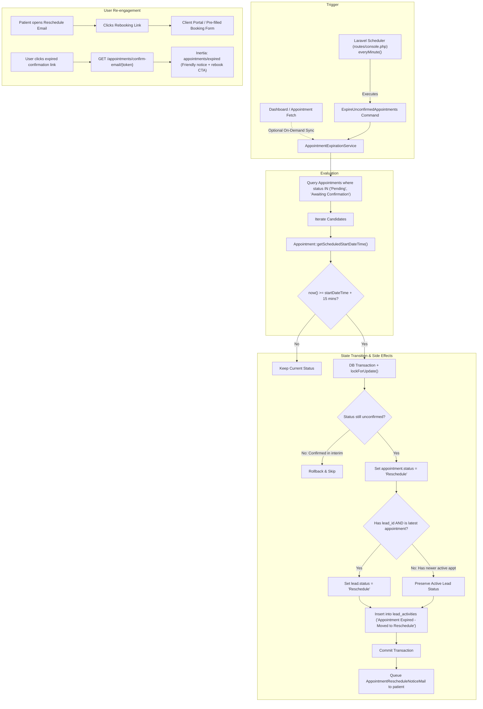

# Automatic Expiration and Reschedule Transition for Unconfirmed Appointments

*   **Author:** allwyn46
*   **Status:** Proposed
*   **Date:** 2026-11-13

--------------------------------------------------------------------------------

## Overview

In specialized clinical practices, unconfirmed patient appointments create operational bottlenecks. When patients or clinicians do not confirm requested or scheduled consultations, those appointments sit in limbo (`Pending` or `Awaiting Confirmation`). They block clinic specialist time slots, distort daily doctor schedule boards, and skew CRM pipeline projections.

This document designs an automated lifecycle policy: unconfirmed appointments that pass their scheduled start time plus a 15-minute clinical grace period are automatically transitioned to `Reschedule` status. The system synchronizes the patient's CRM lead stage (if applicable), preserves email tokens to render an informative rebooking screen instead of an error, logs the clinical activity, and emails the patient a direct link to choose an alternate consultation slot.

## The Problem

1. **Chair-Time & Specialist Availability Waste**:
   Unconfirmed booking requests prevent other prospective patients from selecting those slots online or via front-desk staff.
2. **Ambiguous Daily Schedule State**:
   Doctors and clinic staff looking at the daily schedule view continue to see morning appointments as "Pending" even after mid-day, creating uncertainty about whether a patient might show up or if the slot was forfeited.
3. **Pipeline Metric Distortions**:
   Patients who requested a booking days ago remain counted as active inquiries rather than moving to a clear follow-up/rescheduling bucket in the clinic pipeline.
4. **Front-Desk Dispute Vulnerability (Zero-Grace Risk)**:
   Immediately forfeiting appointments at the precise second of slot start (e.g., 10:00:00 AM) penalizes patients who arrive slightly late or are in the waiting room checking in. A defined 15-minute grace window is needed to separate operational tardiness from complete patient forfeiture.

## Goals

*   **Automated Chair Release**: Release unconfirmed appointment slots automatically 15 minutes after the scheduled start time without requiring manual administrative action.
*   **Status Synchronization**: Update the `Appointment` status to `Reschedule` and synchronize the linked `Lead` status to `Reschedule` if the expired appointment is the lead's latest visit.
*   **Non-Destructive Link Handling**: Preserve email confirmation tokens so patients clicking prior email links receive an actionable expiration page rather than an unhandled 404 error.
*   **Patient Re-engagement**: Dispatch an automated notification email with a direct rebooking link to guide the patient toward selecting an available future slot.
*   **Auditability**: Record an explicit activity entry in `lead_activities` detailing the expiration event and timestamp.

## Non-Goals

*   **Automated Slot Rescheduling**: The system will not automatically assign a new calendar date/time without explicit patient selection and consent.
*   **Multi-Channel Gateways**: SMS and WhatsApp messaging channels are out of scope for this phase; communications will be delivered via email.
*   **Doctor Schedule Overrides**: Clinic administrators and doctors retain manual authority to schedule new appointments for the patient at any time.

## Open Questions

*   None remaining. (15-minute grace period policy, token retention strategy, and lead latest-appointment safety guard were finalized during the brainstorming phase).

## Critical User Journeys (CUJs)

### CUJ 1: Client Portal Unconfirmed Booking Reaches Cutoff
*   **Given**: A patient submitted a booking request via the client portal for today at 10:00 AM (`status: Pending`), but clinic staff did not confirm it before 10:15 AM.
*   **When**: The scheduled background evaluator runs at or after 10:15 AM.
*   **Then**: The appointment status transitions to `Reschedule`. The linked lead status moves to `Reschedule`. A `lead_activities` record is created. An automated email is dispatched to the patient offering an apology for missing the requested window along with a link to book another slot.

### CUJ 2: Dual-Confirmation Scheduled Consultation Expires
*   **Given**: Clinic staff scheduled an appointment for today at 02:00 PM (`status: Awaiting Confirmation`), but neither the doctor nor the patient confirmed the reminder email before 02:15 PM.
*   **When**: The background evaluator executes at 02:15 PM.
*   **Then**: The appointment status transitions to `Reschedule`. Active confirmation tokens remain in the database. When the patient or doctor subsequently clicks their confirmation email link, they are directed to an expiration landing page explaining that the slot was released, with a button to select a new appointment.

### CUJ 3: Late In-Transit Confirmation within Grace Period
*   **Given**: An appointment is scheduled for 10:00 AM. The patient arrives at the clinic at 10:07 AM and confirms the appointment on their phone.
*   **When**: The patient clicks confirm at 10:07 AM (within the 15-minute grace period).
*   **Then**: The appointment transitions normally to `Confirmed`. When the evaluator runs at 10:15 AM, the appointment is ignored because its status is no longer `Pending` or `Awaiting Confirmation`.

--------------------------------------------------------------------------------

## Technical Plan (Architecture)

### Architectural Architecture & System Flow

### Component Breakdown

#### 1. Core Model Enhancement (`app/Models/Appointment.php`)
*   **Method**: `getScheduledStartDateTime(): Carbon`
    *   Parses relative strings (`'Today'`, `'Tomorrow'`) or ISO dates (`'YYYY-MM-DD'`) using the existing `getScheduledDate()` helper.
    *   Parses 12-hour time strings (`'10:00 AM'`, `'02:15 PM'`) via `Carbon::createFromFormat('h:i A', trim($this->time))`.
    *   Returns a fully instantiated Carbon object in the application timezone.
*   **Method**: `isPastGracePeriod(int $graceMinutes = 15): bool`
    *   Returns `$this->getScheduledStartDateTime()->addMinutes($graceMinutes)->isPast()`.

#### 2. Service Layer (`app/Services/AppointmentExpirationService.php`)
*   Encapsulates the expiration business logic to be reusable across both the scheduled console command and on-demand dashboard requests.
*   Executes inside a database transaction with pessimistic row locking (`lockForUpdate()`) to eliminate concurrency race conditions against real-time email confirmation clicks.
*   Evaluates candidate appointments where `status IN ('Pending', 'Awaiting Confirmation')`.
*   Updates `status = 'Reschedule'` on qualifying appointments.
*   Safeguards lead pipeline status: only updates `Lead::status` to `'Reschedule'` if the appointment is the lead's latest scheduled visit.
*   Writes an audit log entry in `lead_activities` detailing the expiration.
*   Queues the `AppointmentRescheduleNoticeMail` to the patient.

#### 3. Console Command (`app/Console/Commands/ExpireUnconfirmedAppointments.php`)
*   **Signature**: `appointments:expire-unconfirmed`
*   Invokes `AppointmentExpirationService::expirePastDueAppointments()`.
*   Scheduled in `routes/console.php` with:
    `Schedule::command('appointments:expire-unconfirmed')->everyMinute()->withoutOverlapping();`

#### 4. Notification Mailable & Template (`app/Mail/AppointmentRescheduleNoticeMail.php`)
*   Queued mailable (`ShouldQueue`) delivering an empathetic message to the patient.
*   Distinguishes between client portal bookings (`Pending` - clinic apology for unfulfilled review) vs lead bookings (`Awaiting Confirmation` - reminder of forfeiture due to non-confirmation).
*   Includes a direct rebooking URL (`/` or `/book-appointment`).

#### 5. Graceful Token Expiration View (`AppointmentController::confirmViaEmail`)
*   Tokens (`patient_token`, `doctor_token`) are retained on the appointment record.
*   When a user visits `/appointments/confirm-email/{token}`, the controller inspects the appointment status:
    *   If `status === 'Reschedule'`, it renders an Inertia page (`appointments/expired`) explaining the release of the slot and providing a clear rebooking button, preventing raw HTTP 404 errors.

#### 6. Frontend Types & UI State
*   `resources/js/types/appointment.ts`: Add `'Reschedule'` to `AppointmentStatus`.
*   `resources/js/components/appointments-table.tsx`: Add badge styling for `Reschedule` (`bg-zinc-100 text-zinc-700 border-zinc-200`).
*   Schedule & Booking Availability: Ensure query filters for available doctor slots exclude appointments in `'Reschedule'` status so freed chairs are immediately rebookable.

--------------------------------------------------------------------------------

## Alternatives Considered

### Alternative A: Strict Start-Time Expiry (Zero Grace Period)

*   **Pros**: Reclaims specialist chair-time at the exact minute of scheduled consultation start.
*   **Cons**: Creates severe front-desk conflict when patients arrive slightly late (e.g. 10:03 AM for a 10:00 AM slot) and find their booking abruptly revoked while standing in the waiting room.
*   **Reason for Rejection**: Rejected by author: Medical and dental clinics experience routine 5–10 minute check-in delays. A strict 0-minute cutoff damages patient trust, whereas a 15-minute grace period provides operational cushion before chair forfeiture.

### Alternative B: Per-Appointment Delayed Job Dispatching

*   **Pros**: Executes immediately at `start_time + 15 minutes` without running a periodic polling query.
*   **Cons**: Brittle under worker downtime; requires complex job cancellation tracking whenever appointments are confirmed, cancelled, or rescheduled before the delay fires.
*   **Reason for Rejection**: Rejected by author: Managing long-delayed queued jobs across thousands of appointments introduces distributed state drift. A periodic scheduler checking unconfirmed appointments (`everyMinute()`) with `withoutOverlapping()` is deterministic, self-healing, and stateless.

### Alternative C: Nullifying Security Tokens on Expiration

*   **Pros**: Guarantees that token strings cannot be reused.
*   **Cons**: Any patient clicking an email link after expiration hits an uncaught `firstOrFail()` 404 HTTP exception.
*   **Reason for Rejection**: Rejected by author: Returning raw 404 pages erodes patient confidence. Retaining the token allows the system to recognize the specific expired booking, greet the patient by name, explain the slot release, and present an immediate rebooking action.

### Alternative D: Direct SQL String Comparisons (`WHERE date <= ? AND time <= ?`)

*   **Pros**: Avoids loading models into memory for evaluation.
*   **Cons**: Lexicographically broken for 12-hour AM/PM strings (e.g. `'02:00 PM'` is smaller than `'10:00 AM'`) and completely fails on relative seeds like `'Today'`.
*   **Reason for Rejection**: Rejected by author: SQL string comparison produces false positives and false negatives. Evaluating parsed Carbon timestamps in PHP guarantees chronological accuracy across all string variants.

--------------------------------------------------------------------------------

## Non-Functional Requirements

### Security & Privacy
*   **Token Protection**: Tokens remain unique cryptographic random strings (40 chars) and only allow viewing the expiration state and rebooking interface.
*   **Patient Confidentiality**: Reschedule notification emails contain only high-level procedure and specialist details, avoiding disclosure of sensitive diagnostic records.

### Performance & Latency
*   **Targeted Polling Query**: The background query is scoped strictly to unconfirmed records (`WHERE status IN ('Pending', 'Awaiting Confirmation')`), which represents a tiny fraction (<1%) of the total appointments table.
*   **Asynchronous Email Handshake**: All notification emails are dispatched via queued mailables (`ShouldQueue`) so slow SMTP handshakes never block the scheduler transaction.

### Rollout & Backward Compatibility
*   **Zero Migration Invalidation**: Existing appointment records remain fully valid. Adding `'Reschedule'` to `AppointmentStatus` extends existing enum types without mutating historical completed or cancelled appointments.

--------------------------------------------------------------------------------

## Detailed Implementation Plan

### Target Files to Create/Modify

#### 1. `app/Models/Appointment.php` (Modify)
*   **Type / Scope**: Eloquent Model & Domain Logic
*   **Proposed Changes**:
    *   Add `getScheduledStartDateTime(): Carbon` helper method to reliably combine `getScheduledDate()` and parsed 12-hour `time` strings into a unified Carbon instance.
    *   Add `isPastGracePeriod(int $graceMinutes = 15): bool` helper method evaluating whether `now() >= start_time + grace_period`.
*   **Rationale**: Standardizes parsing across relative string dates (`'Today'`, `'Tomorrow'`) and formatted times (`'10:00 AM'`), eliminating broken SQL string comparisons.

#### 2. `app/Services/AppointmentExpirationService.php` (Create)
*   **Type / Scope**: Clinical Domain Service
*   **Proposed Changes**:
    *   Implement `expirePastDueAppointments(): int` method.
    *   Query candidate appointments with `whereIn('status', ['Pending', 'Awaiting Confirmation'])`.
    *   Wrap transitions in `DB::transaction()` with pessimistic locking (`lockForUpdate()`).
    *   Evaluate candidates using `$appointment->isPastGracePeriod(15)`.
    *   Mutate appointment `status = 'Reschedule'`.
    *   Synchronize lead status to `'Reschedule'` only if the appointment is the lead's latest scheduled visit.
    *   Create an activity entry in `lead_activities` (`type: 'Status Change'`, `title: 'Appointment Expired - Moved to Reschedule'`).
    *   Dispatch `AppointmentRescheduleNoticeMail` to `$appointment->patient_email`.
*   **Rationale**: Encapsulates business logic in a dedicated service reusable by both scheduled console tasks and real-time request listeners.

#### 3. `app/Console/Commands/ExpireUnconfirmedAppointments.php` (Create)
*   **Type / Scope**: Artisan CLI Command
*   **Proposed Changes**:
    *   Define command signature `appointments:expire-unconfirmed`.
    *   Inject `AppointmentExpirationService` and invoke `expirePastDueAppointments()`.
    *   Output execution summary and count of transitioned appointments.
*   **Rationale**: Provides the executable command scheduled by the framework runner.

#### 4. `routes/console.php` (Modify)
*   **Type / Scope**: Scheduler Configuration
*   **Proposed Changes**:
    *   Register `Schedule::command('appointments:expire-unconfirmed')->everyMinute()->withoutOverlapping();`.
*   **Rationale**: Automates minute-by-minute evaluation in production without overlapping process lockups.

#### 5. `app/Mail/AppointmentRescheduleNoticeMail.php` (Create)
*   **Type / Scope**: Queued Mailable
*   **Proposed Changes**:
    *   Define mailable implementing `ShouldQueue`.
    *   Accept `$appointment` and `$rebookUrl` in constructor.
    *   Configure subject line: `"Update Regarding Your MediPro Appointment Request"`.
    *   Render `emails.appointment_reschedule_notice`.
*   **Rationale**: Delivers patient notification asynchronously without blocking HTTP or scheduler transactions.

#### 6. `resources/views/emails/appointment_reschedule_notice.blade.php` (Create)
*   **Type / Scope**: Email Blade Template
*   **Proposed Changes**:
    *   Create responsive email layout with MediPro clinical branding.
    *   Contextual message body:
        *   If `Pending`: Apologizes that the clinic could not confirm the request in time and invites rebooking.
        *   If `Awaiting Confirmation`: Notes that confirmation was not received prior to cutoff and the slot was released.
    *   Includes prominent button linking to `$rebookUrl`.
*   **Rationale**: Delivers clear, polite patient communication with an immediate rebooking path.

#### 7. `app/Http/Controllers/AppointmentController.php` (Modify)
*   **Type / Scope**: HTTP Controller
*   **Proposed Changes**:
    *   In `confirmViaEmail(Request $request, string $token)`:
        *   Check if `$appointment->status === 'Reschedule'`.
        *   If true, return `Inertia::render('appointments/expired', ['appointment' => $appointment, 'rebookUrl' => route('welcome')])`.
    *   In `bookedSlots()`:
        *   Ensure queries for unavailable slots exclude `'Reschedule'` so freed times become available immediately.
*   **Rationale**: Eliminates 404 errors when patients access old tokens and ensures freed slots are immediately bookable.

#### 8. `resources/js/types/appointment.ts` (Modify)
*   **Type / Scope**: TypeScript Type Definitions
*   **Proposed Changes**:
    *   Add `'Reschedule'` to the `AppointmentStatus` union.
*   **Rationale**: Ensures type-safety across all frontend appointment components and TanStack table models.

#### 9. `resources/js/components/appointments-table.tsx` (Modify)
*   **Type / Scope**: React Component
*   **Proposed Changes**:
    *   Add case `'Reschedule'` to `getStatusBadgeClass`: `bg-zinc-100 text-zinc-700 border-zinc-200 dark:bg-zinc-800 dark:text-zinc-400 dark:border-zinc-700`.
*   **Rationale**: Renders appropriate badge aesthetics when rescheduled appointments appear in table views.

#### 10. `resources/js/pages/appointments/expired.tsx` (Create)
*   **Type / Scope**: Inertia React Page
*   **Proposed Changes**:
    *   Build dedicated "Appointment Slot Expired" view with clinical branding.
    *   Displays patient name, requested specialist, and scheduled date/time.
    *   Presents prominent call-to-action button: "Select a New Appointment Time".
*   **Rationale**: Provides an empathetic recovery journey for patients clicking expired confirmation emails.

#### 11. `tests/Feature/AppointmentExpirationTest.php` (Create)
*   **Type / Scope**: Feature Test Suite (Pest)
*   **Proposed Changes**:
    *   Test unconfirmed appointments within 15 minutes of start are not transitioned.
    *   Test unconfirmed appointments at `start_time + 16 minutes` are transitioned to `Reschedule`.
    *   Test linked lead status is updated to `Reschedule` if the appointment is the lead's latest visit.
    *   Test linked lead status is preserved if the lead has a newer confirmed appointment.
    *   Test `lead_activities` record is created with correct status change metadata.
    *   Test patient notification email is queued.
    *   Test clicking expired token URL renders expiration page instead of 404.
    *   Test confirmed appointments are never expired by the service.
*   **Rationale**: Proves all edge cases and invariants pass automated verification.

### Verification Plan

*   **Compilation & Type Check**: Run `npm run types:check` to verify TypeScript definitions.
*   **Frontend Asset Build**: Run `npm run build` to verify Vite bundle compilation.
*   **Pest Test Suite**: Run `php artisan test --compact --filter=AppointmentExpirationTest` followed by the full test suite `php artisan test --compact`.
*   **Code Style & Standards**: Run `vendor/bin/pint --dirty --format agent` to guarantee PSR-12 formatting on all modified PHP files.

--------------------------------------------------------------------------------

*Drafted with EGM*